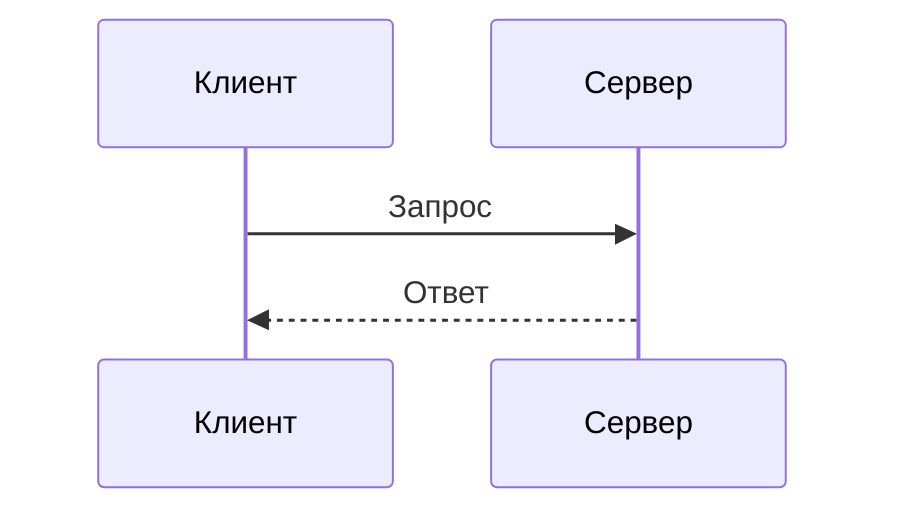

# SpecCraft — студия Markdown

SpecCraft помогает писать технические задания, спецификации требований и лабораторные работы. Текст, таблицы и редактируемые блок-схемы помещаются в один файл `.md`. Его можно передать коллеге, положить в Git или целиком подготовить в другом чате. **[Открыть студию в браузере](https://spec-craft-md.vercel.app/)**

## Быстрый старт

1. При первом открытии появится пример **Бронирование.md**. Нажмите **+** рядом с **Документы**, выберите **Лабораторная работа**, введите имя файла и нажмите **Создать**.
2. В панели **Структура** нажмите **Цель**, затем щёлкните по абзацу под заголовком и напишите цель работы. Нажмите **Готово** над полем или щёлкните по свободной области страницы, чтобы увидеть оформленный текст.
3. Перейдите к разделу **Результаты** и заполните таблицу измерений. Клавиша **Tab** в последней ячейке добавляет строку для следующего опыта.
4. Чтобы передать работу преподавателю, выберите **Экспорт → Скачать PDF**. Чтобы продолжить редактирование на другом компьютере, выберите **Экспорт → Скачать Markdown (.md)**.

## Документы и навигация

| Задача | Как выполнить |
| --- | --- |
| Начать с шаблона | Нажмите **+** рядом с **Документы**. В шаблоне **Техническое задание** уже есть назначение, требования и приёмка. **Спецификация требований** содержит реестр с ID и критериями. **Лабораторная работа** содержит цель, оборудование, ход работы, результаты и контрольные вопросы. Для собственной структуры выберите **Пустой документ**. |
| Открыть существующий файл | Нажмите **Открыть файл** и выберите один или несколько файлов `.md`, `.markdown`, `.txt`, `.mmd` или `.mermaid`. Каждый появится отдельной рабочей копией в списке **Документы**. Файл Mermaid открывается как Markdown с диаграммой. |
| Переименовать | Нажмите **⋯ → Переименовать** у нужного файла слева или имя открытого файла в верхней строке, введите новое имя и нажмите **Сохранить**. Под этим именем студия предложит скачать файл. Заголовок внутри документа редактируется отдельно. |
| Изменить надпись со штрихом | В **Редакторе** или **Markdown** нажмите надпись с карандашом над документом. Введите **Текст надписи** и нажмите **Сохранить**. Чтобы скрыть её в режиме **Чтение**, оставьте поле пустым. Кнопка **Добавить надпись** возвращает её. Надпись хранится в рабочей копии и резервной копии студии. |
| Создать копию | У нужного файла выберите **⋯ → Создать копию**. Студия откроет отдельный документ с тем же текстом, оформлением и схемами. Это удобно перед большой переработкой ТЗ. |
| Убрать файл из списка | Выберите **⋯ → Переместить в корзину**. Команда действует на файл в этой строке. Если вы убрали последний документ, появятся команды создания и открытия файла. |
| Восстановить или окончательно удалить | Откройте **Корзина** внизу левой панели и нажмите **Восстановить** рядом с именем документа. Чтобы освободить место в браузере, выберите **Удалить навсегда** и подтвердите удаление в диалоге с именем файла. Команды корзины относятся к рабочим копиям этого сайта. |
| Перейти к разделу | Нажмите заголовок в панели **Структура**. Оглавление строится по заголовкам документа и обновляется после правки. На узком экране список файлов и оглавление открывает кнопка **Показать документы** в верхнем левом углу. |

## Шаблоны документов

В **Шаблоны** на левой панели доступны заготовки для ТЗ, требований, лабораторной работы, спецификации продукта и API, плана испытаний, архитектурного решения (ADR) и формального документа с титулом. У последнего есть поля для организации, обозначения, редакции и стандарта. Если у вас есть утверждённый образец под конкретный ГОСТ, сохраните его структуру как Markdown и загрузите в библиотеку.

1. Нажмите **Новый шаблон** или **Копировать и настроить** у встроенного. Чтобы взять за основу открытый документ, нажмите **Сохранить документ как шаблон**.
2. Введите название и заполните **Markdown шаблона**. Добавьте заголовки, таблицы, формулы, изображения или блоки схем. Запишите поля для заполнения как `{{Название проекта}}`. Для подписи в схеме поместите поле внутрь значения JSON в кавычках.
3. Нажмите **Предпросмотр**, чтобы увидеть оформление, затем **Сохранить шаблон**. Свой шаблон можно изменить или удалить из библиотеки.
4. Выберите шаблон при создании нового документа или нажмите **Создать документ** в библиотеке. Заполните имя файла и нужные поля. Студия подставит значение во все вхождения поля. Пустые поля останутся в Markdown.
5. Для обмена выберите **Скачать шаблон**. Команда **Импорт шаблона** принимает этот файл `.speccraft.json` или файлы `.md` и `.markdown`. Импорт открывает редактор, где можно проверить содержимое и нажать **Сохранить шаблон**.

## Текст, требования и оформление

**Редактор** показывает оформленный документ. Щёлкните по абзацу или заголовку, чтобы открыть разметку этого блока. Выделите фразу и выберите на панели **Полужирный**, **Курсив**, **Зачёркнутый**, **Маркер**, **Строчный код** или **Ссылка**. Например, для ссылки выделите слова «Методика испытаний», нажмите значок ссылки и введите адрес в выделенное поле внутри скобок.

Нажмите **Готово** на панели блока или щёлкните по свободной области страницы, чтобы завершить ввод и сразу увидеть оформленный текст. С клавиатуры доступны **Ctrl+Enter**, **⌘+Enter** и **Esc**.

### Перемещение блоков и разделов

В **Редакторе** наведите курсор на блок и потяните значок с точками слева. Отпустите его у цветной линии над или под другим блоком. Так можно перемещать абзацы, отдельные заголовки, таблицы, формулы, изображения и диаграммы. На сенсорном экране значки видны постоянно.

В **Структуре** потяните значок с точками справа от заголовка к заголовку того же уровня. Раздел перемещается вместе с содержимым и вложенными подразделами. Для перемещения с клавиатуры поставьте фокус на значок блока или на заголовок в **Структуре** и нажмите **Alt+↑** или **Alt+↓**. **Esc** отменяет незавершённое перетаскивание. Сохранённый перенос можно отменить через **Ctrl+Z** или **⌘+Z**.

**Markdown** открывает исходный текст всего файла. Этот режим удобен для вставки нескольких разделов сразу, изменения уровня заголовка (`##`, `###`) и правки исходника схемы. **Чтение** показывает документ в оформленном виде и убирает инструменты вставки и редактирования блоков.

В исходнике поддерживаются заголовки, списки, цитаты, разделители, ссылки, изображения и Markdown-таблицы. Чтобы дописать пример программного кода, выберите **Вставить → Блок кода**, замените метку `text` на язык, например `javascript`, и вставьте код между ограждающими строками. Короткие выражения можно оформить через **Строчный код**. Для выравнивания столбцов измените разделитель в строке таблицы в режиме **Markdown**. Используйте `:---` для левого края, `:---:` для центра и `---:` для правого края.

- **Вставить блок.** В режиме **Редактор** выберите блок, после которого нужен новый, и нажмите **Вставить**. Если выбранный блок уже за пределами экрана, вставка происходит у текущего места просмотра. Доступны абзац, раздел, таблица, блок-схема, диаграмма Mermaid, требование, блок кода, список, формула LaTeX и изображение. В режиме **Markdown** вставка происходит у курсора. Кнопка **Абзац** внизу документа добавляет текст в конец.
- **Записать проверяемое требование.** Выберите **Вставить → Требование**. Студия найдёт наибольший номер `FR-` в тексте и предложит следующий. Замените название и заполните критерий приёмки. Например, для «FR-03 · Выгрузка отчёта» критерием может быть «Скачанный файл содержит все строки выбранного периода».
- **Изменить вид страницы.** На широком экране нажмите **Оформление документа** внизу левой панели. На телефоне сначала откройте **Показать документы**. Выберите шрифт (с засечками, без засечек или моноширинный), размер, межстрочный интервал, отступ между абзацами, выравнивание и цвет акцента. Для длинного текста можно ограничить ширину строки в режиме чтения и в оформленных блоках до 55, 70 или 85 знаков. Для исходника доступны перенос длинных строк и ширина табуляции. Проверка орфографии использует словарь браузера. Нажмите **Применить**. Эти настройки сохраняются для рабочей копии в этом браузере. Цвета и размеры фигур записываются в саму схему внутри Markdown.

Выделите фразу и нажмите **Маркер**, чтобы записать её в Markdown как `==важно==`, или **Зачёркнутый**, чтобы получить `~~устарело~~`. Оба оформления видны в режиме чтения и в скачанном PDF. В текстовом блоке **Ctrl+B / ⌘B** и **Ctrl+I / ⌘I** применяют полужирный шрифт и курсив.

В **Редакторе** и режиме **Markdown** можно обрамлять выделение с клавиатуры. Нажмите обратную кавычку для строчного кода, `*` или `_` для курсива, `~` для зачёркивания, `=` для маркера или `$` для формулы. Текст внутри обрамления остаётся выделенным. Нажмите `*` ещё раз для полужирного текста или `[` дважды для внутренней ссылки. Круглые, квадратные и фигурные скобки, а также одинарные и двойные кавычки добавляются парой.

Чтобы выбрать цвет, выделите текст и нажмите стрелку **Цвет маркера** рядом со значком **Маркер** и выберите цветной круг в палитре. Цвет сохраняется в Markdown, например `==важно=={pink}`. Доступны жёлтый, зелёный (`green`), голубой (`blue`), розовый (`pink`), сиреневый (`violet`) и оранжевый (`orange`). Для жёлтого достаточно `==важно==`. Чтобы перекрасить выделение, выберите его текст внутри `==` и задайте новый цвет. Цвет виден в чтении, согласовании и PDF.

Чтобы удалить блок целиком, нажмите значок корзины рядом с ним в режиме **Редактор**. У схемы он находится в заголовке, у таблицы внизу есть кнопка **Удалить таблицу**. На компьютере значок у текстовых блоков появляется при наведении или фокусе. Чтобы восстановить блок, нажмите **Отменить** в верхней панели или **Ctrl+Z / ⌘+Z** вне поля ввода.

## Изображения

Выберите **Вставить → Изображение** и загрузите PNG, JPEG, WebP или GIF либо укажите прямой адрес HTTP или HTTPS. В поле **Описание для изображения** кратко опишите рисунок. Этот текст используется программами чтения с экрана. Нажмите **Вставить изображение**. В **Редакторе** рисунок появится рядом с выбранным блоком, а в **Markdown** разметка вставится у курсора.

Загруженный файл встраивается в Markdown и переезжает вместе с ним. Крупные файлы сжимаются, при сжатии анимации сохраняется один кадр. Ссылка отображает файл с исходного сервера. Для переноса изображения в PDF по ссылке сервер должен разрешать его встраивание. Чтобы изменить описание или адрес, откройте блок изображения или режим **Markdown** и исправьте строку вида ``.

## Формулы LaTeX

- **Внутри текста.** Откройте абзац в режиме **Редактор** и нажмите **Формула в строке** на панели блока. Замените выделенный пример своим выражением. В исходнике можно сразу написать `$E = mc^2$` или `\( E = mc^2 \)`. В ячейке таблицы введите формулу с такими же разделителями. Обычный знак доллара можно записать как `\$`.
- **Отдельный блок.** Выберите **Вставить → Формула LaTeX**. В блоке выделено выражение между строками `$$`. Для многострочной выкладки используйте `aligned`, для матрицы `pmatrix` или `bmatrix`, для кусочной функции `cases`. Разделители `\[` и `\]` тоже поддерживаются. Номер отдельной формулы можно задать командой `\tag{1}`.
- **Правка и проверка.** Нажмите по формуле, чтобы открыть её исходник и предпросмотр под полем ввода. **Ctrl+Enter** или **⌘+Enter** завершает правку. При ошибке студия покажет исходник и отметку **Ошибка LaTeX**. На узком экране широкую формулу можно прокрутить внутри блока.
- **Перенос и экспорт.** При скачивании `.md` сохраняется LaTeX. В режиме **Чтение** и в версии для согласования формулы видны в оформленном виде. Команды **Скачать PDF** и **Печать** сохраняют формулы в строке или отдельном блоке согласно исходной разметке.

Пример исходного Markdown для лабораторной работы.

```markdown
Среднее значение обозначим $\bar{x}$.

$$
\begin{aligned}
\bar{x} &= \frac{1}{n}\sum_{i=1}^{n}x_i, \\
s^2 &= \frac{1}{n-1}\sum_{i=1}^{n}(x_i-\bar{x})^2.
\end{aligned}
$$
```

## Таблицы

Нажмите **Вставить → Таблица** или откройте таблицу из шаблона. Щёлкните по ячейке и введите значение. **Enter** завершает правку, **Tab** переводит к следующей ячейке. В последней ячейке **Tab** создаёт строку и переводит курсор в её начало.

Чтобы изменить размеры таблицы, сначала щёлкните по опорной ячейке. При выделении заголовка **+ Строка** вставляет первую строку данных. Кнопка **+ Строка** добавляет строку ниже, **+ Столбец** — столбец справа. Кнопки **− Строка** и **− Столбец** удаляют выбранную строку данных или столбец. После добавления курсор переходит в новую ячейку. Пустые ячейки сразу имеют место для ввода. Широкую таблицу можно прокручивать внутри блока.

Для переноса измерений из электронной таблицы скопируйте прямоугольный диапазон из нескольких столбцов. Щёлкните в ячейку, которая станет верхним левым углом диапазона, и вставьте данные. Студия раскладывает текст по табуляциям и переводам строк, при необходимости расширяет таблицу и заменяет значения в области вставки.

## Как рассмотреть большую схему в документе

По умолчанию в режимах **Редактор** и **Чтение** схема открывается в масштабе **100%**. Для каждой схемы можно сохранить другой способ вписывания. Если архитектура шире страницы или выше экрана, подписи сохраняют свой размер. Прокручивайте область рисунка, тяните её мышью или сдвигайте пальцем на телефоне.

| Задача | Действие |
| --- | --- |
| Увидеть все компоненты и связи сразу | Нажмите **Вписать целиком** под рисунком. |
| Прочитать мелкие детали | Нажимайте **+** и **−** под рисунком. Кнопка с процентом, а после вписывания **1:1**, возвращает исходный масштаб. |
| Использовать почти весь экран | Нажмите **Развернуть** над схемой. Рисунок займёт ширину документа, а текст выше и ниже останется доступен. **Свернуть** возвращает заданные автором размеры. |
| Развернуть все схемы документа | Нажмите **Развернуть все схемы** над началом документа в **Редакторе** или **Чтении**. **Свернуть все схемы** возвращает размеры всех блоков. У каждой схемы есть свои кнопки масштаба и сворачивания. |

Масштаб просмотра действует на экране. При печати или сохранении PDF студия учитывает ширину и положение блока и вписывает полный рисунок в доступную область страницы. Исходные размеры фигур и координаты в Markdown сохраняются при просмотре.

## Диаграммы Mermaid

Выберите **Вставить → Диаграмма Mermaid** и измените пример. Можно вставить готовый блок с меткой `mermaid` в режиме **Markdown** или выбрать файл `.mmd` или `.mermaid` через **Открыть файл**.



Студия отображает диаграммы Mermaid в **Редакторе**, **Чтении**, предпросмотре шаблона и документах по ссылке. Например, можно вставить блок-схему, диаграмму последовательности, ER-диаграмму, диаграмму классов или Гантта. Нажмите **Изменить код**, чтобы открыть исходник и увидеть предпросмотр под полем. **Код Mermaid** раскрывает исходник в режиме чтения. Кнопки **Вписать** и **Развернуть** меняют размер просмотра. При ошибке студия показывает сообщение и сохраняет исходник для правки.

При скачивании `.md` сохраняется исходный код Mermaid. **Экспорт → Скачать PDF** встраивает диаграмму как изображение повышенного разрешения. Если в коде ошибка, в PDF попадут сообщение и исходник. **Печать** использует диаграмму из предпросмотра. Для перетаскивания отдельных фигур и визуальной правки маршрутов используйте блок **Блок-схема**.

## Визуальный редактор блок-схем

Нажмите **Изменить** над рисунком или выберите **Вставить → Блок-схема**. Холст открывается на месте рисунка. Свойства расположены справа от документа, на узком экране — под ним. Например, чтобы добавить в процесс согласования ветку возврата заявки, выполните следующие действия.

1. Выберите **Операция** в верхнем списке, нажмите **+ Фигура** и в поле **Подпись** введите «Доработать заявку». Перетащите блок под условие проверки. Размер можно изменить маркером в правом нижнем углу или в полях **Ширина** и **Высота**.
2. Нажмите **Связать**, щёлкните сначала по фигуре условия, затем по новой операции. Порядок выбора определяет направление стрелки.
3. Щёлкните по связи и введите подпись «Нет». Если тонкую линию трудно выбрать, найдите её по названию или ID узлов в списке **Выбрать элемент схемы**.
4. Чтобы обойти соседнюю фигуру, задайте стороны подключения в полях **Начало** и **Конец**, нажмите **Добавить точку изгиба** и перетащите точку на холсте. **Сбросить точки** убирает ручные изгибы. Для маршрута в обход фигур нажмите **Проложить стрелки**.
5. Нажмите **Готово**, чтобы убрать инструменты и вернуться к чтению. Действия на холсте уже записаны в Markdown. Можно сразу перейти к следующему абзацу. Если нужен отдельный рисунок для презентации, кнопка **SVG** в редакторе скачает текущее изображение. Для дальнейшей правки сохраните и сам документ в `.md`.

| Что выбрано | Что можно настроить |
| --- | --- |
| **Вся схема** | Название над рисунком. Выберите **Вся схема** в списке элементов, чтобы его изменить. Кнопки **−** и **+** меняют масштаб рабочего холста. |
| Фигура | Форму (операция, терминатор, условие, данные, эллипс, компонент или база данных), подпись, заливку, обводку, цвет и размер текста, ширину, высоту, скругление и толщину контура. |
| Связь | Подпись и её смещение по X и Y, цвет и толщину линии, пунктир, наконечник, стороны подключения, прямой, ломаный или кривой маршрут и точки изгиба. |

Для архитектуры продукта используйте **Компонент** для сервиса и **База данных** для хранилища. Выберите оформленную фигуру и нажмите **Дублировать фигуру**, чтобы создать рядом такую же фигуру с собственным ID. Переименуйте её и добавьте нужные связи. Чтобы ровно расставить блоки, включите **По сетке** на панели холста. Привязка действует при перемещении фигур и точек изгиба, а также при изменении размера фигуры мышью.

**Удалить фигуру** удаляет также её входящие и исходящие связи. Чтобы убрать одну стрелку, выберите её и нажмите **Удалить связь**. У холста есть собственные кнопки отмены и повтора. Кнопка **Отменить действие** на панели схемы отменяет последнюю правку, включая перемещение целого модуля. Включите **Перемещать холст** и потяните рисунок мышью или пальцем, чтобы открыть другую часть схемы. Повторное нажатие возвращает выбор и перемещение фигур. В просмотре и редакторе можно также потянуть нижний ползунок вправо, чтобы увидеть правую часть схемы.

### Выделение, выравнивание и модули

1. Обведите нужные фигуры рамкой, потянув от пустого места на холсте. Для точного набора используйте **Shift + щелчок**. На сенсорном экране включите **Выделение** и поочерёдно коснитесь фигур. Повторный щелчок или касание в этом режиме снимает выделение с фигуры.
2. Потяните любую выделенную фигуру. Весь набор переместится на одинаковое расстояние. Точки изгиба связей между выбранными фигурами переместятся вместе с ними.
3. Чтобы выстроить сервисы в ряд, выберите **Способ выравнивания → По верхнему краю** и нажмите **Выровнять**. Также доступны левый, правый и нижний края и центр по каждой оси.
4. Нажмите **Объединить в модуль**, введите название, например «Приём заказов», и выберите цвет. Модуль отображается рамкой с названием. Перетащите её за фон или заголовок, чтобы сдвинуть весь модуль. Отдельную фигуру по-прежнему можно выбрать через список элементов в панели свойств.
5. Чтобы включить ещё один сервис, выберите фигуру и укажите **Принадлежность к модулю**. **Без модуля** выводит выбранные фигуры из группы. **Разгруппировать** убирает рамку выбранного модуля и сохраняет фигуры и связи. У одной фигуры может быть один модуль.

### Кривые и UML-классы

- **Кривая связь.** Выберите стрелку, затем **Маршрут → Кривая**. Через **Добавить точку изгиба** задайте точку, через которую должна пройти кривая, и перетащите её. Стороны подключения, цвет и пунктир задаются в той же панели.
- **Класс.** Выберите **UML · Класс → + Фигура**. В поле **Подпись** введите имя класса, в **Атрибуты класса** и **Методы класса** — по одному члену на строку. Например, для класса «Заказ» подойдут атрибут `+ id: UUID` и метод `+ подтвердить()`. На рисунке они займут отдельные секции.
- **Отношения.** У связи поле **Наконечник** поддерживает наследование (пустой треугольник), агрегацию (пустой ромб) и композицию (закрашенный ромб). Символ рисуется у конечной фигуры. Для наследования при создании связи выберите сначала подкласс, затем базовый класс.

### Размер блока на странице

**Размер блока** внизу холста можно потянуть, чтобы изменить ширину и высоту мышью. Щелчок по этой же кнопке открывает **Размещение в документе** в свойствах. Там можно задать точные значения.

| Параметр | Результат |
| --- | --- |
| **Ширина блока, %** | От 25 до 100% ширины текста. Для архитектуры всей системы удобно оставить 100%, для небольшой схемы одного сервиса — выбрать меньшую ширину. |
| **Высота, px (0 — авто)** | При 0 высота просмотра подбирается автоматически. Для фиксированной области задайте от 150 до 1400 пикселей. |
| **Положение** | Выравнивает сам блок слева, по центру или справа на странице. |
| **Вписывание** | **Целиком** показывает всю схему в блоке. **По ширине** заполняет ширину и допускает вертикальную прокрутку. **Натуральный размер** сохраняет читаемый размер подписей и позволяет прокручивать крупные схемы. |

Нажмите **Готово**, чтобы увидеть выбранное размещение. Оно хранится в Markdown вместе с модулями и UML-элементами. Кнопки **+** и **−** под готовым рисунком меняют только временный масштаб просмотра.

## Связи требований, компонентов и проверок

Откройте **Связи требований** слева. На телефоне эти команды находятся под **Показать документы**. Реестр собирает требования с ID вида `FR-01`, `NFR-02`, `REQ-03` или `BR-04` из заголовков и таблиц. Для таблицы используйте столбец **ID** либо поместите ID в первый столбец. **Добавить требование** вставляет следующий свободный номер FR. У каждого требования должен быть свой ID.

1. В примере **Бронирование.md** выберите **FR-02 · Подача заявки**. Отметьте фигуру **Жизненный цикл заявки · Заявка**. Через **К фигуре** можно открыть её в документе. В режиме чтения команда прокручивает страницу к фигуре.
2. Введите «Автор получает номер заявки» в **Название новой проверки** и нажмите **Создать проверку**. Студия добавит в конец документа раздел с очередным ID `TC-…` и ссылкой на FR-02. Нажмите **К проверке** и опишите шаги и ожидаемый результат. Существующую проверку можно отметить сразу у нескольких требований.
3. Вернитесь в реестр и включите **Только без проверки**, чтобы найти пробелы. Критерий приёмки из таблицы виден в карточке требования. В счётчик проверок входят связанные разделы TC.
4. Снимите флажок у фигуры или проверки, чтобы отвязать её. Из свойств выбранной фигуры также доступны **Связать с требованием**, переход по ID и кнопка отвязки.

Связи переносятся вместе с файлом. В JSON фигуры это поле `"requirements": ["FR-02"]`. У проверки это заголовок, например `## TC-01 · Номер заявки`, и отдельный абзац `Проверяет: [[FR-02]]`. Для нескольких требований добавьте по такому абзацу на каждое. Этот же формат можно поручить другому чату через **Для ИИ**.

## Авторасстановка и маршруты

В документе нажмите **Изменить** у схемы. Чтобы сохранить положение отдельного блока, выберите его и нажмите **Закрепить позицию** в свойствах. **Открепить позицию** снова разрешает перемещать его при авторасстановке.

- **Авторасстановка** распределяет фигуры по направлению связей, оставляет интервалы и перестраивает прилегающие стрелки. Выделите несколько фигур или модуль, чтобы ограничить область их перемещения. При выборе одной обычной фигуры или пустого холста команда работает со всей схемой.
- **Проложить стрелки** оставляет прямые связи в свободном проходе и строит ломаные маршруты вокруг фигур. Чтобы перестроить только нужные связи, щёлкните по первой стрелке, затем добавьте другие через **Shift + щелчок**. На сенсорном экране включите **Выделение** и касайтесь нужных стрелок. Повторный щелчок с **Shift** или касание в режиме **Выделение** снимает выбор. Выбранные связи подсвечиваются. Нажмите **Проложить стрелки**. При выборе фигур команда перестраивает их входящие и исходящие связи, а на пустом выделении — всю схему. Координаты фигур, цвета, подписи и UML-наконечники сохраняются. Если перекрывающиеся фигуры закрывают выход, сообщение под холстом покажет число непроложенных связей.
- Чтобы вернуться к ручным изгибам или прежнему расположению, нажмите **Отменить действие** сразу после команды. Закрепление, координаты и новые точки маршрутов сохраняются в Markdown.

### Участки маршрута и проверка читаемости

- Выберите стрелку. На горизонтальных и вертикальных участках ломаной появятся ручки. Потяните ручку поперёк линии, чтобы сдвинуть весь участок и перестроить подходы. Короткая связь без места для изгиба может не показать ручку.
- Щёлкните ручку или выберите **Участок маршрута** в свойствах, затем нажмите **Закрепить участок**. При перемещении фигуры и автопрокладке концы связи перестраиваются вокруг закреплённого участка. Если фигура перекрыла его, студия сообщает о проблеме. Чтобы снова разрешить изменение участка, выберите его и нажмите **Открепить участок**. Команда **Сбросить точки** снимает закрепления этой стрелки и очищает изгибы.
- При перестроении маршрута студия прокладывает подход к закреплённому участку без разворота по тому же отрезку. Если в старом маршруте линия уходила в сторону и возвращалась по тому же отрезку, этот отросток скрывается при просмотре.
- Нажмите **Проверить схему** на панели холста. В свойствах появится список пересечений стрелок, наложений подписей и фигур без связей. Нажмите замечание, чтобы выделить фигуру или связь и перейти к месту на холсте. Список обновляется по мере правки.

## Внутренние ссылки и обратные ссылки

В текстовом блоке или в режиме **Markdown** введите `[[` и несколько букв названия. Выберите подсказку мышью или стрелками и нажмите **Enter**. **Esc** закрывает подсказки. Примеры для одного документа:

| Запись | Куда ведёт |
| --- | --- |
| `[[Назначение системы]]` | К заголовку с таким названием. |
| `[[FR-02]]` | К строке таблицы или заголовку требования. |
| `[[TC-01\|проверка заявки]]` | К проверке TC-01, с подписью «проверка заявки». |

Нажмите ссылку в **Редакторе** или **Чтении** для перехода в том же окне. В левой панели **Ссылки разделов** выберите цель, чтобы увидеть все обратные ссылки и перейти к месту упоминания. При одинаковых названиях студия предложит выбрать раздел. Ненайденные цели перечислены отдельно. Внутри строчного кода и блоков кода двойные скобки остаются обычным текстом.

## Версии для согласования

1. Откройте **Версии**, введите название, например «Передано на ревью», и нажмите **Зафиксировать версию**. Сохраняются полный Markdown и оформление на этот момент. Рабочий документ остаётся открыт.
2. После правок снова откройте **Версии**, выберите снимок и нажмите **Сравнить с документом**. Раскройте изменение, чтобы увидеть значения **В версии** и **Сейчас**. Сравнение показывает разделы и текст, строки таблиц, фигуры, связи, модули и оформление. Пункт **Полный Markdown** позволяет проверить точный исходник, включая порядок блоков.
3. Укажите **Статус версии**: **На согласовании**, **Согласована** или **Требует доработки**. Статус относится к выбранному снимку. После следующего этапа правок можно зафиксировать новую версию.
4. Для передачи рецензенту нажмите **Скачать Markdown версии**. История и статусы хранятся у рабочей копии в этом браузере и доступны после перезагрузки. Скачанный Markdown содержит содержимое выбранной версии. Для обсуждения в браузере используйте ссылку на согласование.

### Согласование с коллегой по ссылке

1. Откройте **Версии**, выберите снимок и нажмите **Создать ссылку для коллеги**. Отправьте ссылку удобным способом. Каждый, у кого она есть, сможет прочитать этот снимок и оставить замечание под указанным именем.
2. Коллега нажимает **Замечания** в строке требования или выбирает фигуру на схеме. В панели сбоку указано место замечания. Там же можно выбрать другой блок или весь документ. Имя может содержать до 80 символов, текст замечания — до 2000. В одном снимке можно оставить до 250 замечаний. Введите имя, напишите замечание и нажмите **Оставить замечание**.
3. У себя откройте **Версии → выбранная версия → Открыть замечания**. Нажмите название требования или фигуры, чтобы перейти к нужному месту. Под замечанием выберите **Ответить**, введите текст и нажмите **Отправить ответ**. Коллега увидит его в той же ветке. **Отметить учтённым** ставит отметку, **Открыть снова** снимает её. Панель обновляется раз в 30 секунд, а кнопка **Обновить** запрашивает изменения сразу.
4. Чтобы отозвать ссылку, в панели замечаний нажмите **Закрыть доступ по ссылке**. Автор по-прежнему может открыть замечания из сохранённого снимка.

Снимки публикуются в приватном Vercel Blob по явной команде автора. Правки рабочего Markdown видны коллегам после публикации новой версии. Для авторского доступа храните рабочую копию или резервную копию студии.

## Совместная работа над общим документом

1. Откройте документ и нажмите **Поделиться** в верхней панели. Выберите **Роль по ссылке**, нажмите **Создать ссылку** и передайте её коллеге. При первом открытии общего документа или создании ссылки студия публикует рабочую копию на сервере. Действующая ссылка даёт указанную роль любому, у кого она есть.
2. В этом же меню нажмите **Открыть общий документ**. Дальнейшие совместные правки делайте в общем документе через **Редактировать документ**. Исходная локальная копия доступна в списке **Документы**. Чтобы скачать актуальный общий Markdown, в общем редакторе выберите **Экспорт → Скачать Markdown (.md)**.
3. В списке **Активные ссылки** нажмите **Копировать** у нужной ссылки или **Отозвать**, чтобы закрыть доступ по ней. Для другого уровня доступа выпустите новую ссылку с нужной ролью.

| Роль | Доступ |
| --- | --- |
| **Читатель** | Открывает актуальный документ и его схемы. |
| **Комментатор** | Читает документ, оставляет замечания ко всему документу, требованию или фигуре. Может отвечать в ветках. |
| **Редактор** | Имеет права комментатора и редактирует общий Markdown, таблицы и схемы. Правки сохраняются в общем документе. |
| **Автор** | Редактирует, отвечает с отметкой автора, закрывает и повторно открывает замечания. Создаёт и отзывает ссылки. Авторский доступ хранится в рабочей копии и резервной копии студии. |

Чтобы оставить замечание, выберите требование, фигуру или **Весь документ**, укажите имя и нажмите **Оставить замечание**. Под сообщением выберите **Ответить**, затем нажмите **Отправить ответ**. Из общего редактора к этой панели ведёт **Обсуждение** в верхней строке. Просмотр и редактирование открываются в той же вкладке.

Редакторы видят сохранённые правки коллег через несколько секунд. Пока открыт редактируемый блок, ячейка, схема или поле исходника, обновление страницы ждёт завершения ввода. Независимые правки объединяются. Когда правки пересекаются, нажмите **Сравнить правки** в нижней строке. Можно принять вариант коллеги или объединить тексты вручную в поле **Мой вариант** и сохранить. Если связь пропала, черновик восстанавливается при повторном входе в редактор в этой вкладке. Его также можно скачать через **Экспорт**.

Общий Markdown ограничен 750 КБ. В одном обсуждении поддерживаются до 250 замечаний и 250 ответов.

### Точечные замечания и предложения

- Откройте общий документ или нажмите **Обсуждение** в общем редакторе. Чтобы обсудить фразу, выделите её в одном текстовом блоке и нажмите **Комментировать выделение**. Для ячейки или связи включите **Выбрать ячейку или стрелку** и щёлкните по нужному элементу. Введите замечание и нажмите **Оставить замечание**. В списке **Все замечания** нажмите название места над сообщением, чтобы перейти к нему и подсветить его. Ветка остаётся доступна, если исходный фрагмент удалён или его положение стало неоднозначным.
- Чтобы предложить изменение, выделите фразу и нажмите **Предложить правку**. На вкладке **Предложения** можно выбрать фрагмент из списка. Выберите таблицу и нажмите **Предложить новую строку**, чтобы заполнить строку с нужным количеством столбцов. Для изменения стрелки включите **Выбрать ячейку или стрелку** на вкладке **Предложения**, щёлкните по связи и заполните её свойства. Нажмите **Отправить предложение**.
- Автор открывает **Предложения**, сверяет добавления и удаления и нажимает **Принять** или **Отклонить** под нужной правкой. Принятие создаёт новую редакцию общего документа. Если исходный текст успел измениться и место нельзя надёжно определить, студия просит обновить предложение.

### История общего документа

Вкладка **История** доступна автору и редактору. Выберите **Редакция общего документа**, чтобы увидеть автора, время правки и отличия от текущего текста. Редактор может указать своё имя через **Участники общего документа** перед правкой.

Автор может выбрать раздел или схему в **Часть документа для сравнения** и нажать **Восстановить часть**. Студия создаст новую редакцию с восстановленным фрагментом. Если раздел или схема были удалены, команда **Восстановить в конце документа** добавит выбранный фрагмент. Для однозначного сопоставления разделов давайте соседним разделам разные заголовки и сохраняйте ID схем в исходнике. Хранятся до 30 последних редакций. Для крупных документов может остаться меньше редакций. У ранее опубликованного документа история начинается с редакции, доступной при первом сохранении после обновления.

### Согласование по разделам

Откройте **Согласование**. Автор выбирает **Раздел для согласования**, указывает **Ответственный**, устанавливает **Статус раздела** и нажимает **Сохранить статус**. Команда **К разделу** переносит к соответствующему месту в документе. После изменения согласованного текста раздел получает отметку **Требует доработки**.

Сводка **Перед выпуском** показывает открытые замечания, ожидающие решения предложения, несогласованные разделы и требования, у которых отсутствует критерий приёмки или связанная проверка. Нажмите на требование в сводке, чтобы перейти к нему.

### Присутствие коллег

В общем документе откройте **Участники**. В редакторе тот же список открывает кнопка **Участники общего документа** вверху. Укажите **Имя в документе**. В списке видны роли коллег и разделы или схемы, в которых они работают. Присутствие обновляется примерно раз в 15 секунд, неактивная сессия исчезает из списка примерно через 45 секунд.

## Резервная копия студии

В меню **Перенос данных** можно скачать резервную копию локальных документов вместе с пользовательскими шаблонами, версиями и авторским доступом к согласованиям и общим документам. Актуальный общий текст доступен через **Поделиться → Открыть общий документ**. Выберите **Загрузить резервную копию** в другом браузере, чтобы продолжить работу. Если в студии уже есть документ с тем же ID и отличающимся содержимым, импорт создаёт копию. Храните этот JSON у себя.

## Как написать весь документ в другом чате

1. Для новой работы создайте документ из подходящего шаблона. Для доработки откройте существующий файл. Нажмите **Для ИИ** внизу левой боковой панели. На телефоне сначала нажмите **Показать документы**.
2. В поле **Что нужно написать или изменить?** сформулируйте задачу. Например, «Дополни раздел проверки ввода примером на JavaScript. Привяжи фигуру к FR-01, добавь отдельную проверку пустого ввода и верни весь документ».
3. Нажмите **Скопировать запрос** и вставьте его в нужный чат. Запрос содержит задание, текущий Markdown, синтаксис кода, таблиц, ссылок, изображений, требований, проверок и схем, а также цельный пример. В чате попросите вернуть файл `.md` или полный Markdown внутри одного блока с четырьмя обратными кавычками и меткой `markdown`. Такое ограждение позволяет сохранить тройные ограждения кода и схем внутри документа. Отправку выполняете вы в выбранном чате. Если браузер предложил ручное копирование, нажмите **Ctrl+C** или **⌘+C**.
4. Если чат вернул готовый файл, выберите **Открыть файл** в студии. Чтобы сравнить ответ с исходной работой, скопируйте **полный текст** результата и в исходном документе откройте **Для ИИ → Вставить результат → Сравнить**.
5. Просмотрите список добавленных, изменённых и удалённых разделов. Сравнение группирует текст по заголовкам первого и второго уровня. Раскройте **Полный текст результата**, затем выберите **Открыть копией**, чтобы сохранить оба варианта, или **Применить**, чтобы заменить содержимое текущего документа целиком.

### Что переносится через Markdown

| Данные | Где хранятся и как править |
| --- | --- |
| Текст, примеры кода, таблицы, формулы LaTeX, ссылки, изображения, требования и проверки | В Markdown. Чат может редактировать их и вернуть в студию одним файлом. |
| Фигуры, стрелки, принадлежность к модулям, связи с требованиями, закрепление фигур и участков маршрутов, размеры схемы на странице | В JSON внутри блока `studio-diagram`. Чат может менять эти поля по заданию, а результат можно открыть на холсте. |
| Диаграммы Mermaid | В блоках Markdown с меткой `mermaid`. Чат может менять их исходный код и вернуть диаграммы в одном файле с документом. |
| Шрифт и оформление страницы, библиотека шаблонов, локальные версии и их статусы, авторский доступ к замечаниям | В рабочей копии браузера. Для переноса между браузерами используйте **Перенос данных**. |
| Опубликованный снимок и замечания | В хранилище согласования. Откройте зафиксированную версию через **Версии**. Чтобы учесть замечание в запросе к ИИ, добавьте его в поле задания. |
| Общий документ, роли по ссылкам, ветки обсуждения, предложения, облачная история и статусы разделов | В приватном хранилище совместной работы. Откройте его через **Поделиться**. Для обмена с ИИ скачайте актуальный общий Markdown через **Экспорт**. |

### Пример Markdown для вставки

Скопируйте содержимое блока в **Для ИИ → Вставить результат** и нажмите **Сравнить → Открыть копией**. В **Редакторе** откроются таблица требований, редактируемая схема и пример кода. У FR-01 будут видны фигура «Проверить» и проверка TC-01. Для вставки поясняющего фрагмента в существующий документ используйте режим **Markdown** и разместите его в нужной части файла.

````markdown
# Пример спецификации

## Требования

| ID | Требование | Критерий приёмки |
| --- | --- | --- |
| FR-01 | Проверить входные данные | Пустой ввод отклоняется |

## Обработка

```studio-diagram
{
  "version": 1,
  "title": "Проверка ввода",
  "layout": {
    "width": 100,
    "height": 0,
    "align": "left",
    "fit": "contain"
  },
  "modules": [
    {
      "id": "validation",
      "title": "Валидация",
      "color": "#7b72bc"
    }
  ],
  "nodes": [
    {
      "id": "start",
      "label": "Ввод",
      "shape": "start",
      "x": 40,
      "y": 70
    },
    {
      "id": "check",
      "label": "Проверить",
      "shape": "process",
      "x": 250,
      "y": 70,
      "moduleId": "validation",
      "requirements": [
        "FR-01"
      ]
    }
  ],
  "edges": [
    {
      "id": "start-check",
      "from": "start",
      "to": "check",
      "label": "Данные"
    }
  ]
}
```

Пример кода для [[FR-01|проверки ввода]].

```javascript
function hasValue(value) {
  return value.trim().length > 0;
}
```

### TC-01 · Пустой ввод

Проверяет: [[FR-01]]

1. Вызвать функцию с пустой строкой.
2. Убедиться, что функция возвращает false.
````

### Справочник по JSON схемы

Блок `studio-diagram` размещается отдельно между тройными обратными кавычками. Внутри используется JSON с двойными кавычками. Для редактируемых схем из другого чата просите этот формат. В других Markdown-просмотрщиках он обычно отображается как исходный код.

| Часть схемы | Поля |
| --- | --- |
| Корневой объект | `version: 1`, `title`, массивы `nodes` и `edges`. Дополнительно `modules` и `layout`. |
| Фигура | Уникальный строковый `id`, строка `label` и `shape`. Формы: `process`, `start`, `decision`, `data`, `ellipse`, `database`, `component`, `umlClass`. |
| Геометрия и стиль фигуры | `x`, `y`, `width`, `height`, `fontSize`, `radius`, `weight`, цвета `fill`, `stroke`, `textColor` в формате `#RRGGBB`. Для новой фигуры можно опустить координаты и размеры. |
| Дополнительные сведения о фигуре | Для класса `attributes` и `methods` задаются строками с переносами `\n`. `requirements` перечисляет ID требований. `pinned: true` закрепляет позицию при авторасстановке. В `moduleId` указывается ID модуля. |
| Связь | Уникальный `id`, `from` и `to` с ID фигур. Подпись `label`, смещение `labelX` и `labelY`, `color`, толщина `weight` и флаг `dashed` задаются дополнительно. |
| Подключение и маршрут | `fromSide` и `toSide` принимают `auto`, `left`, `right`, `top`, `bottom`. `route` принимает `orthogonal`, `straight`, `curve`. `points` хранит точки с числовыми `x` и `y`. В `lockedSegments` по порядку записываются пары `{from:{x,y},to:{x,y}}` для закреплённых горизонтальных и вертикальных участков. `arrow` принимает `end`, `none`, `inheritance`, `aggregation`, `composition`. |
| Модуль | Элемент массива `modules` содержит уникальный `id`, название `title` и `color`. |
| Размер и положение блока | `layout.width` в процентах (25–100), `layout.height` в пикселях (0 для авто или 150–1400), `layout.align` (`left`, `center`, `right`), `layout.fit` (`actual`, `contain`, `width`). |

При сообщении **Ошибка схемы** проверьте синтаксис JSON, уникальность идентификаторов и соответствие `from`, `to` и `moduleId` существующим элементам. При правке сохраняйте ID существующих элементов, чтобы связи оставались на месте.

## Сохранение, экспорт и клавиши

После правки проверьте строку состояния внизу. **Сохранено на устройстве** означает, что рабочая копия записана в хранилище этого сайта в текущем браузере. Открытие файла с диска создаёт рабочую копию. Чтобы получить обновлённый файл на диске, скачайте его через **Экспорт**. Очистка данных сайта может удалить локальные документы.

| Нужный результат | Действие |
| --- | --- |
| Продолжить работу на другом устройстве или сохранить версию в Git | **Экспорт → Скачать Markdown (.md)**. Файл включает текст, таблицы и редактируемые схемы. На другом устройстве загрузите его через **Открыть файл**. |
| Передать оформленный документ для чтения | **Экспорт → Скачать PDF**. Скачивается готовый PDF с выделяемым текстом, таблицами и векторными схемами. В документ попадает вся схема вместе с подписями, независимо от прокрутки и увеличения на экране. Сетка холста, дата печати, название сайта, адрес и номера страниц в файл не добавляются. |
| Напечатать через системный диалог | **Экспорт → Печать**. Принтер, формат бумаги и колонтитулы выбираются в браузере. |
| Получить только рисунок | Откройте схему кнопкой **Изменить** и нажмите **SVG**. |

В меню **Экспорт** по умолчанию включено **Увеличивать лист для крупных схем**. Если на A4 подписи станут слишком мелкими, схема получит отдельный лист подходящего размера, а текст продолжится на A4. Для сдачи работы строго на A4 снимите флажок перед скачиванием. Кириллические шрифты встраиваются в PDF. Если изображение из Markdown недоступно или сайт запрещает его встраивание, студия укажет проблемное изображение.

| Клавиши | Где работают и что делают |
| --- | --- |
| **Backspace**, **Delete** | На холсте удаляют выбранные связи или фигуры. При выборе модуля удаляются его фигуры и связанные с ними стрелки. Действие можно отменить кнопкой **Отменить действие**. В поле подписи Backspace стирает текст. |
| **Ctrl+S** / **⌘+S** | В основном окне сохраняют рабочую копию и скачивают текущий Markdown. |
| **Ctrl+Enter** / **⌘+Enter**, **Esc** | В текстовом блоке завершают редактирование и показывают результат. Введённые изменения сохраняются и при **Esc**. |
| **/** | В режиме **Редактор** открывает меню вставки вне поля ввода. Также можно ввести один символ `/` в пустом текстовом блоке. |
| **Ctrl+Z** / **⌘+Z**, с **Shift** для повтора | В открытом редакторе схемы вне поля ввода отменяют и повторяют действия на холсте. В документе отменяют и повторяют правки блоков. В текстовых полях работают сочетания браузера для отмены набора. Клавиша Z работает и в кириллической раскладке вне полей ввода. Кнопки **Отменить** и **Повторить** доступны в верхней панели документа. |

## Локальный запуск

Запустите HTTP-сервер из корня репозитория.

```sh
python3 -m http.server 8000 --directory public
```

Откройте [локальную студию](http://localhost:8000). Клиент и библиотеки находятся в `public/`. Локальный статический сервер подходит для редактирования Markdown. Согласование по ссылке и совместная работа используют функции `api/review.js`, `api/collaboration.js` и подключённое приватное хранилище Vercel Blob. Для локальной проверки запустите `vercel dev` в проекте, где хранилище подключено к окружению Development. Настройки публикации этого каталога на Vercel находятся в [vercel.json](./vercel.json).

Mermaid 12.3.0 поставляется из `public/vendor/mermaid/` и загружается при первом показе диаграммы в изолированном кадре. Синтаксис описан в [руководстве Mermaid](https://mermaid.js.org/intro/).

Движок формул MathJax загружается из `public/vendor/mathjax/` при первом показе формулы. Для обновления поставляемого браузерного бандла pdfmake 0.3.14 примените `node scripts/patch-pdfmake-inline-svg.mjs public/vendor/pdf/pdfmake.min.js` к чистому файлу этой версии. Скрипт добавляет поддержку векторных формул в текстовых строках PDF.

## История обновлений

### 20 ноября 2026

- Добавлены отрисовка Mermaid, вставка и правка кода с предпросмотром, открытие файлов `.mmd` и `.mermaid`, отображение при согласовании и экспорт в PDF.
- Добавлено перетаскивание отдельных блоков в редакторе и разделов с подразделами в оглавлении. Перенос поддерживает отмену и клавиши Alt+↑ / Alt+↓.
- В общем документе появились замечания к выделенному тексту, ячейкам и стрелкам, предложения с принятием или отклонением, облачная история с восстановлением отдельных разделов и схем, согласование по разделам и присутствие коллег.
- Добавлены общие документы, отзываемые ссылки с ролями читателя, комментатора и редактора, совместное редактирование с объединением независимых правок и сравнение пересекающихся изменений.
- Под замечаниями к версии и общему документу появились ветки с ответами автора.
- Исправлены отростки на маршрутах стрелок. **Проложить стрелки** умеет перестраивать сразу несколько выбранных связей. **Ctrl+Z / ⌘+Z** отменяет действия на холсте и в кириллической раскладке.
- Надпись со штрихом над документом можно редактировать и скрывать. У кнопки **Готово** убрана заливка.
- Текстовый блок возвращается к оформленному виду по кнопке **Готово** или при клике по свободной области страницы.
- Добавлены **Развернуть все схемы** и **Свернуть все схемы**. Переход между просмотром и редактированием схемы удерживает её положение на странице.
- Появились проверка читаемости схемы с переходом к замечаниям, перенос целых участков стрелок и их закрепление при автопрокладке.
- Добавлены библиотека шаблонов, пять новых заготовок, редактор с предпросмотром и полями, импорт Markdown и обмен шаблонами в JSON.
- Изображения можно загружать в Markdown или вставлять по ссылке. Цвет маркера выбирается в компактной палитре рядом с иконкой.

- Выделенный текст можно обрамлять с клавиатуры в **Редакторе** и режиме **Markdown**. Для маркера добавлена палитра с сохранением цвета в Markdown, согласовании и PDF.
- Кнопка перемещения холста получила пояснение. Автопрокладка держит изгибы в стороне от портов, а наконечники рисуются перед контуром фигур.
- Исправлен экспорт нумерованных формул LaTeX с `\tag` в PDF.

- Добавлены формулы LaTeX в абзацах и таблицах, отдельные блоки и предпросмотр при вводе. Формулы поддерживаются в чтении, согласовании и экспорте. В запрос **Для ИИ** добавлены правила записи и переноса формул.

### 19 ноября 2026

- Вставка блоков и правка таблиц сохраняют место в документе. Новые строки и столбцы сразу получают удобный размер, а курсор переходит к месту ввода.
- Добавлено удаление блоков, таблиц и схем кнопкой. Команда **Отменить** доступна и на узком экране.

- README и запрос **Для ИИ** дополнены актуальными правилами работы со студией. Добавлен пример полного Markdown с кодом, таблицей требований, связанной проверкой и схемой, а также справочник JSON.

- Согласование повторяет запрос при кратковременной недоступности сервера. После обрыва сети повтор той же отправки сохраняет одно замечание, даже если рецензент уже переключался между требованиями и схемами.

- Исправлено восстановление после повреждения отдельной записи в браузере. Остальные документы открываются, а правки открытого документа при конфликте сохраняются в копии.

- Появились ссылки на зафиксированные версии и замечания у требований и фигур схем. Автор видит их в студии, может отметить учтёнными и закрыть доступ по ссылке.
- Добавлен перенос документов и версий через резервную копию с сохранением авторского доступа к замечаниям.

- Добавлены реестр связей требований с фигурами и проверками, фильтр непокрытых требований и переходы к компонентам и тестам.
- Авторасстановка и прокладка стрелок работают на холсте документа с учётом закреплённых фигур и выделенных модулей.
- Ссылки `[[раздел]]` поддерживают автодополнение, подписи, переходы, поиск обратных ссылок и диагностику отсутствующих целей.
- Именованные версии сохраняют Markdown и оформление. Доступны статусы согласования, сравнение с рабочим документом и скачивание снимка.

- Студия получила имя **SpecCraft**. Существующие документы доступны по прежнему адресу.
- Добавлено прямое скачивание PDF с векторными схемами, встроенными шрифтами и отдельными листами для крупной архитектуры. Системная печать доступна отдельной командой.
- Исправлена горизонтальная прокрутка схемы ползунком. Выбранные элементы можно удалять клавишами Backspace и Delete.
- Расширены параметры типографики и редактирования исходника. В тексте доступны маркер, зачёркивание и клавиши для полужирного и курсивного начертания.

- Холст схемы теперь открывается прямо в документе. Свойства, вставка блоков, экспорт и обмен с ИИ доступны в боковой панели той же страницы.
- Появились выделение рамкой и по щелчку, совместное перемещение, выравнивание, именованные модули, кривые связи и UML-классы с атрибутами, методами и тремя типами наконечников.
- Для каждого рисунка можно сохранить ширину, высоту, положение и способ вписывания в Markdown. Эти настройки переносятся при повторном открытии файла.

- В списке документов появилось меню действий для переименования, создания копии и перемещения в корзину. Документы из корзины можно восстановить или удалить окончательно.
- Большие схемы открываются в читаемом масштабе. В документе и режиме чтения доступны увеличение, прокрутка, вписывание и развёрнутый просмотр. Для архитектурных схем добавлены фигуры компонента и базы данных, дублирование и привязка к сетке.
- Команда **Для ИИ** перенесена в нижнюю часть левой боковой панели.

- Опубликована первая версия студии с шаблонами документов, редактированием таблиц и схем, обменом полным документом с другим чатом и экспортом в Markdown, PDF и SVG.
- Добавлено руководство с примерами заполнения таблицы, построения ветки блок-схемы и возврата документа из чата.
