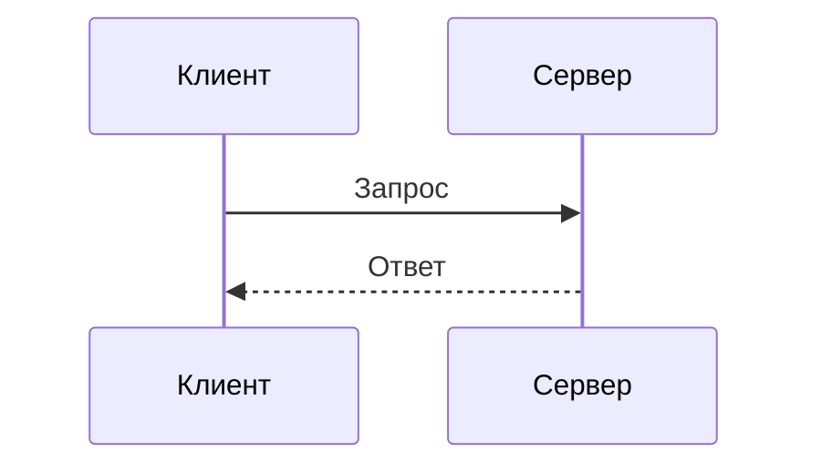

# SpecCraft

SpecCraft помогает писать технические задания, спецификации требований и лабораторные работы. Текст, таблицы и редактируемые блок-схемы помещаются в один файл `.md`. Его можно передать коллеге, положить в Git или целиком подготовить в другом чате. **[Открыть SpecCraft MD в браузере](https://spec-craft-md.vercel.app/)**

## Быстрый старт

1. При первом открытии появится пример **Бронирование.md**. Нажмите **+** рядом с **Документы**, выберите **Лабораторная работа**, введите имя файла и нажмите **Создать**.
2. В панели **Структура** нажмите **Цель**, затем щёлкните по абзацу под заголовком и напишите цель работы. Нажмите **Готово** над полем или щёлкните по свободной области страницы, чтобы увидеть оформленный текст.
3. Перейдите к разделу **Результаты** и заполните таблицу измерений. Клавиша **Tab** в последней ячейке добавляет строку для следующего опыта.
4. Чтобы передать работу преподавателю, выберите **Экспорт → Скачать PDF**. Чтобы продолжить редактирование на другом компьютере, выберите **Экспорт → Скачать Markdown (.md)**.

**Навигация по руководству**

| Что вы хотите сделать | Где читать |
| --- | --- |
| Настроить заготовку для команды | [Библиотека и редактор шаблонов](#шаблоны-документов) |
| Написать документ на холсте, в Markdown или LaTeX | [Исходник и предпросмотр](#исходник-и-результат-в-одном-окне), [оформление и вставка блоков](#текст-требования-и-оформление) |
| Оформить техническую часть | [Таблицы](#таблицы), [формулы](#формулы-latex), [изображения](#изображения), [дерево проекта, оглавление и литература](#структура-проекта-оглавление-и-литература) |
| Построить архитектуру | [Mermaid](#диаграммы-mermaid), [визуальный редактор](#визуальный-редактор-блок-схем), [авторасстановка и маршруты](#авторасстановка-и-маршруты) |
| Связать и согласовать требования | [Связи и проверки](#связи-требований-компонентов-и-проверок), [версии](#версии-для-согласования), [роли, комментарии и совместная работа](#совместная-работа-над-общим-документом) |
| Передать результат | [Размещение блоков, поля и печать](#предпросмотр-и-разбиение-на-листы), [резервная копия](#резервная-копия-студии), [задание для другого чата](#как-написать-весь-документ-в-другом-чате) |
| Узнать, что сохранится и как перенести работу | [Где хранятся данные](#где-хранятся-данные) |
| Продолжить личную работу на другом устройстве | [Личная синхронизация](#личная-синхронизация) |

## Документы и навигация

Чтобы открыть руководство из студии, нажмите значок **Проект и документация на GitHub** на узкой левой полосе над **Личной синхронизацией**. Репозиторий SpecCraft с этим руководством откроется в новой вкладке.

| Задача | Как выполнить |
| --- | --- |
| Начать с шаблона | Нажмите **+** рядом с **Документы**. В шаблоне **Техническое задание** уже есть назначение, требования и приёмка. **Спецификация требований** содержит реестр с ID и критериями. **Лабораторная работа** содержит цель, оборудование, ход работы, результаты и контрольные вопросы. Для собственной структуры выберите **Пустой документ**. |
| Открыть существующий файл | Нажмите значок папки **Открыть файл** на узкой левой полосе или в заголовке **Документы**. Выберите один или несколько файлов `.md`, `.markdown`, `.txt`, `.mmd`, `.mermaid` или ранее сохранённых проектов `.speccraft`. Каждый появится отдельной рабочей копией. Файл Mermaid открывается как Markdown с диаграммой. |
| Создать папку | Нажмите значок папки с плюсом **Новая папка** в заголовке **Документы**, введите название и нажмите **Сохранить**. Щёлкните по папке, чтобы свернуть или раскрыть её. В меню **⋯** папки доступны **Новая вложенная папка**, **Переименовать** и **Удалить пустую папку**. |
| Переместить файл | Перетащите файл на строку папки. Чтобы вернуть его в корень, отпустите над заголовком **Документы**. При перетаскивании подсвечивается заголовок или папка назначения. Можно также выбрать **⋯ → Переместить в папку** и указать путь или **Без папки**. |
| Выделить несколько файлов | Удерживайте **⌘** на Mac или **Ctrl** в других системах и щёлкайте по отдельным файлам. **Shift** выделяет диапазон видимых файлов. Перетащите любой выделенный файл, чтобы переместить всю группу. Щёлкните в пустом месте списка, чтобы оставить выделенным открытый документ. |
| Свернуть список файлов | Нажмите надпись **Документы**, стрелку или свободное место в этой строке. Заголовок останется сверху с кнопками открытия и создания файла, а раскрытая **Структура** займёт освободившееся место. Повторное нажатие вернёт список. Состояние запоминается в браузере. |
| Найти файл | Нажмите лупу **Поиск по файлам** в заголовке **Документы** и введите часть имени. Совпадения подсвечиваются. Нажмите Enter, чтобы открыть первый найденный файл. Повторное нажатие лупы или Esc в поле закроет поиск и вернёт весь список. |
| Переименовать файл или папку | Выберите строку и нажмите **F2** или **⋯ → Переименовать**. Введите имя прямо в строке и нажмите **Enter**. Если выделено несколько файлов, поля открываются по очереди. **Esc** завершает переименование и отменяет несохранённый ввод. Имя открытого файла также можно изменить в верхней строке. |
| Изменить надпись со штрихом | В **Редакторе** нажмите надпись с карандашом над документом. Введите **Текст надписи** и нажмите **Сохранить**. Чтобы скрыть её в режиме **Чтение**, оставьте поле пустым. Кнопка **Добавить надпись** возвращает её. Надпись хранится в рабочей копии и резервной копии студии. |
| Создать копию | У нужного файла выберите **⋯ → Создать копию**. Студия откроет отдельный документ с тем же текстом, оформлением и схемами. Это удобно перед большой переработкой ТЗ. |
| Убрать файл из списка | Выберите **⋯ → Переместить в корзину**. Команда действует на файл в этой строке. Если вы убрали последний документ, появятся команды создания и открытия файла. |
| Восстановить или окончательно удалить | Откройте **Инструменты → Корзина** внизу левой панели и нажмите **Восстановить** рядом с именем документа. Чтобы освободить место в браузере, выберите **Удалить навсегда** и подтвердите удаление в диалоге с именем файла. Чтобы удалить все документы из корзины, нажмите **Очистить корзину**, проверьте количество и подтвердите удаление. Команды корзины относятся к рабочим копиям этого сайта. |
| Перейти к разделу | Нажмите заголовок в панели **Структура**. Оглавление строится по заголовкам документа и обновляется после правки. На узком экране список файлов и оглавление открывает кнопка **Показать документы** в верхнем левом углу. |
| Настроить высоту структуры | Нажмите надпись **Структура**, стрелку или свободное место в этой строке, чтобы свернуть панель до заголовка внизу или развернуть её. Когда оба списка раскрыты, потяните горизонтальную границу между ними. С клавиатуры перейдите на разделитель и нажимайте ↑ или ↓. Двойной щелчок по границе или Enter возвращает исходную высоту. Списки прокручиваются независимо, а размер и состояние панели запоминаются в браузере. |
| Найти раздел | Нажмите лупу **Поиск по структуре** и введите часть заголовка. Совпадения подсвечиваются даже в свёрнутых ветках. Родительские заголовки видны для контекста. Щёлкните по нужному пункту или нажмите Enter, чтобы перейти к первому совпадению. Повторное нажатие лупы или Esc в поле вернёт обычный список. |
| Свернуть подразделы | Нажмите стрелку слева от заголовка в **Структуре**, чтобы свернуть вложенную ветку. При раскрытии сохраняется состояние подразделов. Кнопка **Свернуть все подразделы** рядом с лупой сворачивает все ветки. Повторное нажатие разворачивает все уровни. Выбор запоминается в этом браузере для каждого документа. |
| Открыть инструменты | Нажмите строку **Инструменты** внизу левой панели. Список команд откроется поверх развёрнутой **Структуры** и прокручивается отдельно. Если **Структура** свёрнута, её заголовок останется доступен над инструментами. Повторное нажатие на **Инструменты** закроет команды. На телефоне сначала откройте боковую панель кнопкой **Показать документы**. |
| Изменить ширину левой панели | Наведите указатель на правую границу и потяните, когда появится двусторонняя стрелка. Так меняется ширина панели **Документы** и **Структура**. На телефоне сначала откройте её через **Показать документы**. С клавиатуры перейдите к разделителю клавишей Tab и нажимайте ← или →. Двойной щелчок по границе или Enter на разделителе возвращает исходную ширину. Выбранный размер запоминается в браузере. |
| Изменить ширину правой панели | Откройте свойства схемы или любую команду, которая открывается в правой панели. Перетащите её левую границу вправо, чтобы освободить место для холста. С клавиатуры перейдите к разделителю клавишей Tab и нажимайте ← или →. Двойной щелчок или Enter возвращает исходную ширину. Выбранный размер общий для правых панелей и запоминается в браузере. На узком экране настройки открываются под документом. |
| Освободить место для документа | На узкой полосе слева нажмите значок **Скрыть верхнюю панель** сразу под логотипом SpecCraft. Свернутся строка с именем файла и строка с режимами и инструментами. Чтобы вернуть их, нажмите **Показать верхнюю панель** на том же месте. На телефоне откройте боковую панель через кнопку **Документы**. Переключатель находится под логотипом внутри боковой панели. Выбор сохраняется в браузере. |

Чтобы закрыть правую панель, снова нажмите кнопку, которой открыли её, например **Поделиться**, **Экспорт** или **Оформление документа**. Там же работают кнопка **Закрыть** в заголовке и клавиша **Esc**.

Когда места в редакторе мало, **Вставить**, **Поделиться** и **Экспорт** отображаются значками. При необходимости команды редактора переходят на следующую строку.

## Где хранятся данные

| Что вы открываете | Где хранится | Как продолжить работу |
| --- | --- | --- |
| Личный документ из списка **Документы** | В хранилище сайта в вашем профиле браузера (`localStorage`). В личном пространстве документы и папки также сохраняются в приватном Vercel Blob для синхронизации. | В том же браузере откройте тот же адрес сайта. Для другого устройства используйте [личную синхронизацию](#личная-синхронизация) или [резервную копию](#резервная-копия-студии). |
| Общий документ из меню **Поделиться** | После первой публикации отдельная копия хранится в приватном Vercel Blob. Туда сохраняются совместные правки, комментарии, предложения, история и статусы согласования. | Коллега открывает ссылку со своей ролью. Автор открывает **Поделиться → Открыть общий редактор** из связанного личного документа. Чтобы обновить исходный личный файл, выберите **Подтянуть правки из общего документа**. |
| Опубликованный снимок из меню **Версии** | В приватном Vercel Blob хранится опубликованная редакция и её обсуждение. Черновик и зафиксированные версии остаются в личной студии. | Коллега открывает ссылку на снимок. Автор открывает **Инструменты → Версии**, выбирает снимок и нажимает **Открыть замечания**. |

**Открыть файл** создаёт рабочую копию в браузере. Правки в ней сохраняются автоматически. Чтобы записать результат на диск, выберите **Экспорт → Скачать Markdown (.md)**. Если в двух вкладках одновременно править один личный документ, при конфликте сохранения студия может создать отдельную копию с вашими правками.

Очистка данных сайта может удалить документы и авторский доступ из этого профиля. Сделайте резервную копию перед сменой браузера или очисткой данных. Если внизу появилось **Локальное сохранение недоступно · скачайте .md**, сразу скачайте открытый документ через **Экспорт**. Большие встроенные изображения и зафиксированные версии занимают место в хранилище браузера.

Обычная отмена действий действует в ходе работы. Для сравнения важных этапов после перезагрузки используйте **Инструменты → Версии → Зафиксировать версию**. Чтобы вернуть личный файл после перемещения в корзину, откройте **Инструменты → Корзина → Восстановить**.

## Личная синхронизация

Работать в SpecCraft можно без входа. В локальной студии доступны редактор, папки, шаблоны, экспорт и публикация по ссылке. Чтобы видеть один список личных файлов на нескольких устройствах, откройте **Личная синхронизация** на левой полосе или через **Инструменты**.

1. На устройстве, где уже есть файлы, нажмите **Создать приватный ключ** и сохраните его, например в менеджере паролей.
2. В браузере, где создано пространство, установите флажок **Добавить локальные документы и папки с этого устройства**, затем нажмите **Открыть личное пространство**. Там же после входа доступна команда **Личная синхронизация → Добавить локальные документы и папки**.
3. Дождитесь подтверждения синхронизации. На другом устройстве выберите **Войти по ключу** и вставьте тот же ключ. Откроется список файлов этого пространства. Локальные документы второго браузера доступны после выхода из него. Файлы, созданные уже в личном пространстве, синхронизируются с обоих устройств.

В панели синхронизации можно сравнить **Код пространства** на двух устройствах и увидеть число файлов и папок. Кнопка **Синхронизировать сейчас** сразу проверяет изменения. При пересекающихся изменениях одного файла редактор сохраняет оба варианта, добавляя файл с пометкой «конфликт синхронизации».

Привязка локального списка к браузеру записывается при создании нового пространства. В ранее созданных пространствах доступен текущий облачный список, включая файлы, добавленные до обновления.

Вместе с документом синхронизируются настройки его оформления, сохранённые версии, корзина и привязка к общему документу. Пользовательские шаблоны, тема и размеры панелей хранятся в браузере. Ранее опубликованные общие документы и обсуждения по-прежнему открываются через **Поделиться** или **Версии**. Для работы по ссылке опубликуйте нужный документ отдельной командой.

При потере сети открытые личные документы сохраняются в этом браузере. Дождитесь синхронизации и выберите **Выйти из личного пространства**, чтобы вернуться к локальному списку. Вход по ключу даёт доступ к файлам пространства, поэтому передавайте ключ только на свои устройства. Сохранённый ключ можно открыть через **Личная синхронизация → Показать приватный ключ** на устройстве, где выполнен вход.

## Шаблоны документов

В разделе **Инструменты → Шаблоны** доступны заготовки для ТЗ, требований, лабораторной работы, спецификации продукта и API, плана испытаний, архитектурного решения (ADR) и формального документа с титулом. У последнего есть поля для организации, обозначения, редакции и стандарта. Если у вас есть утверждённый образец под конкретный ГОСТ, сохраните его структуру как Markdown и загрузите в библиотеку.

1. Нажмите **Новый шаблон** или **Копировать и настроить** у встроенного. Чтобы взять за основу открытый документ, нажмите **Сохранить документ как шаблон**.
2. Введите название и заполните **Markdown шаблона**. Добавьте заголовки, таблицы, формулы, изображения или блоки схем. Запишите поля для заполнения как `{{Название проекта}}`. Для подписи в схеме поместите поле внутрь значения JSON в кавычках.
3. Раскройте **Значения полей по умолчанию**. Например, задайте свою организацию один раз и оставьте название проекта для заполнения при каждом создании. Значение можно заменить в форме нового документа.
4. В **Текст и интервалы** выберите шрифт, размер, цвет акцента, выравнивание и интервалы. Заголовки можно выровнять отдельно и включить **Заголовки цветом акцента**. Эти настройки видны на холсте и в PDF. В **Параметры страниц PDF** задайте профиль печати, ориентацию, четыре поля в миллиметрах, начало разделов и нумерацию. **Сохранить документ как шаблон** подставляет текст и текущее оформление открытой работы.
5. Нажмите **Предпросмотр**, чтобы проверить текст с подставленными значениями, затем **Сохранить шаблон**. Страницы для печати можно проверить во вкладке **PDF** созданного документа.
6. В библиотеке нажмите **Создать документ**, проверьте имя и значения полей и нажмите **Создать**. Все вхождения получают одно значение. Если поле пустое, в тексте остаётся его метка. Для уже написанной работы выберите шаблон с оформлением и нажмите **Применить оформление к документу**. Эта команда меняет настройки текста и печати, сохраняя содержание.
7. **Скачать шаблон** сохраняет структуру, значения полей и оформление в одном файле `.speccraft.json`. **Импорт шаблона** открывает его для проверки и сохранения. Можно также загрузить обычный `.md`, `.markdown` или прежний JSON-шаблон. Оформление можно задать после импорта. В **Перенос данных** резервная копия включает библиотеку со всеми настройками.

Ранее скачанный проект `.speccraft` можно открыть через **Открыть файл**. Редактор восстановит Markdown и встроенные изображения. Печатные реквизиты старого проекта сохраняются в исходнике как комментарий. Для передачи текста используйте **Экспорт → Скачать Markdown (.md)**.

## Исходник и результат в одном окне

Откройте **Markdown** или **LaTeX** в верхней панели. Исходник и результат занимают всю рабочую область. Для изменения ширины наведите указатель на границу между исходником и результатом. Когда появится двусторонняя стрелка, потяните границу. Клавиши ← и → меняют ширину выбранного разделителя, двойной щелчок или Enter возвращает исходное соотношение. На узком экране исходник находится над результатом.

Справа при первом открытии выбран режим **Блоки**. Он показывает правку текста при вводе и сохраняет уже построенные соседние блоки. Для точной проверки страниц выберите **Печатный вид**. Он показывает тот же PDF, который скачивается через **Экспорт**. Во время набора последний готовый лист остаётся виден. Через 650 мс после последнего ввода студия начинает обновлять печатный вид. На больших документах построение листов занимает время. Для работы с одним исходником выберите **Скрыт**. Студия запоминает выбор в этом браузере.

Флажок **Следовать за текстом** связывает прокрутку исходника и результата, включая переход между страницами длинной таблицы. Щёлкните по абзацу в предпросмотре, чтобы выделить его исходник.

В **Markdown** флажок **Свернуть вложения** заменяет длинные ссылки на изображения и данные Excalidraw короткими метками. Подпись, ширина изображения и ограждения блока Excalidraw остаются видны. Чтобы редактировать адрес или JSON, снимите флажок. Копирование метки и экспорт Markdown включают полный исходник вложения.

**LaTeX** редактирует тот же документ. Например, изменение `\subsection{Входные данные}` переименует заголовок второго уровня на холсте и в Markdown. Поддерживаются абзацы, заголовки, полужирный и курсив, ссылки, строчный код, простые списки, таблицы `tabular`, формулы и отдельные иллюстрации. У встроенных фотографий в `includegraphics` видны короткие имена. Блоки со сложной разметкой и схемы представлены ссылками вида `\SpecBlock{3}` или `\SpecListing{3}`. Для редактирования их содержимого откройте **Редактор** или **Markdown**. Произвольные команды и окружения за пределами поддержанного набора сохраняются как исходник в блоке `speccraft-latex`, который можно продолжить редактировать. Команда **Вставить** добавляет новый блок после текущего и выделяет его исходник. Компиляция внешних TeX-пакетов в этот режим не входит.

## Текст, требования и оформление

**Редактор** показывает оформленный документ. Щёлкните по абзацу или заголовку, чтобы открыть разметку этого блока. Выделите фразу и выберите на панели **Полужирный**, **Курсив**, **Зачёркнутый**, **Маркер**, **Строчный код** или **Ссылка**. Например, для ссылки выделите слова «Методика испытаний», нажмите значок ссылки и введите адрес в выделенное поле внутри скобок.

Нажмите **Готово** на панели блока или щёлкните по свободной области страницы, чтобы завершить ввод и сразу увидеть оформленный текст. Внутри текстового блока **Enter** добавляет новую строку. **Shift+Enter**, **Ctrl+Enter**, **⌘+Enter** и **Esc** завершают правку. **Shift+Enter** также завершает работу в ячейке таблицы и редакторах схем, рисунков, дерева проекта и библиографии.

После **Готово** или завершения правки клавишами фокус возвращается на блок. Нажимайте **↑** или **↓**, чтобы перейти к соседнему блоку с текстовым исходником, в том числе к заголовку, формуле, коду или Mermaid. **Enter** открывает его для правки. Стрелки пропускают таблицы, визуальные блок-схемы, Excalidraw и блоки со своими настройками. К их кнопкам можно перейти через **Tab**.

Для списка задач начните строки с `- [ ]` или `- [x]`. Для отдельного флажка начните абзац с `[ ]` или `[x]`. В **Редакторе** щёлкните по флажку, чтобы отметить задачу или снять отметку. Состояние сохраняется в исходном Markdown и видно в **Чтении**, предпросмотре и PDF.

### Вставка в выбранное место

В **Редакторе** щёлкните по блоку, после которого нужен новый, и нажмите **Вставить** в верхней панели. В меню **Вставить блок** выберите нужный тип. При открытии меню выбранный блок остаётся на месте. После выбора студия показывает новый блок сразу под ним. В режиме **Markdown** вставка происходит у курсора.

### Структура проекта, оглавление и литература

- **Структура проекта.** Выберите **Вставить → Структура проекта**. В редакторе справа выберите папку или файл в дереве. Можно изменить имя и комментарий, добавить файл или папку, поднять элемент, опустить его или поменять уровень вложенности. Нажмите **Сохранить структуру**. Кнопка **Изменить структуру** открывает редактор и у уже вставленного дерева. Студия распознаёт деревья с ветками `├──` и `└──` в текстовых ограждениях. **Скопировать Markdown** копирует обычный блок `text` с ветками и комментариями. Его отобразит любой редактор, поддерживающий блоки кода Markdown.
- **Оглавление.** Выберите **Вставить → Оглавление**. Студия добавит вложенный список ссылок на заголовки документа. В поле **Обозначения** на самом блоке выберите **Маркеры** или **Номера разделов**. Во втором случае верхние разделы получают обозначения `1.`, `2.`, `3.`, а вложенные — `1.1.`, `1.2.`, `1.2.1.`. Чтобы, например, пропустить название документа H1, откройте **Состав оглавления → Уровни заголовков**, снимите H1 и нажмите **Применить**. Можно выбрать любую комбинацию H1–H6. В списке **Разделы без номера или маркера** отметьте нужные заголовки, например «Перечень терминов». Они сохраняют ссылку и страницу и пропускаются при подсчёте номеров. В режиме **Номера разделов** ручной номер в начале заголовка (например, `1.2.`) показывается один раз. Следующий заголовок того же уровня без номера продолжает последовательность. Чтобы пересчитать все номера по выбранным уровням, выберите **Автонумерация**. В режиме **Маркеры** ручной префикс скрывается. Во всех случаях текст заголовка в документе сохраняется целиком. Настройки действуют для одного оглавления и сохраняются в Markdown. Отметка сохраняется при переименовании и переносе раздела в редакторе. Оглавление обновляет ссылку и номер страницы. Если переносите раздел вручную в режиме исходника, переносите вместе с ним служебный комментарий `<!-- spec-heading-id: … -->` перед заголовком. Обозначения разделов входят в Markdown и PDF. В печатном виде включите **Номера страниц**, чтобы рядом с каждой строкой появилась точечная линия и справа — страница начала раздела. Это работает и для маркеров, и для номеров разделов. При выключенном флажке оглавление содержит только обозначения и названия. Заголовок самого оглавления пропускается. При переименовании, добавлении или переносе раздела список обновляется автоматически, а одинаковые заголовки получают разные ссылки. Щёлкните по ссылке для перехода. **Скопировать Markdown** копирует список, а экспорт `.md` включает актуальную разметку ссылок. В других редакторах переходы работают, если они создают якоря заголовков по правилам GitHub. [Правила ссылок на заголовки GitHub](https://docs.github.com/en/get-started/writing-on-github/getting-started-with-writing-and-formatting-on-github/basic-writing-and-formatting-syntax#section-links)
- **Список литературы.** Выберите **Вставить → Список литературы**. Форма открывается прямо на месте блока. Введите реквизиты источников, при необходимости добавьте курсив или ссылку по правилам Markdown. В поле **Оформление списка** выберите `1.`, маркеры `•` или номера `[1]`. Стрелки меняют порядок, номера пересчитываются автоматически. Нажмите **Сохранить список** или **Отменить**. Для повторной правки нажмите **Изменить список**. Выбранный формат сохраняется в `.md` обычной разметкой Markdown и отображается в PDF.

Заголовки на холсте, в боковой **Структуре**, во вставленном **Оглавлении** и в PDF показывают обычный текст без строчного форматирования. Уровень заголовка задаёт оформление всей строки. Формулы отрисовываются в масштабе окружающего текста. Исходные символы Markdown доступны при редактировании.

### Перемещение и удаление блоков и разделов

В **Редакторе** наведите курсор на блок и потяните значок с точками слева. Отпустите его у цветной линии над или под другим блоком. Так можно перемещать абзацы, отдельные заголовки, таблицы, формулы, изображения и диаграммы. На сенсорном экране значки видны постоянно.

В **Структуре** потяните значок с точками справа от заголовка к заголовку того же уровня. Раздел перемещается вместе с содержимым и вложенными подразделами. Для перемещения с клавиатуры поставьте фокус на значок блока или на заголовок в **Структуре** и нажмите **Alt+↑** или **Alt+↓**. **Esc** отменяет незавершённое перетаскивание. Сохранённый перенос можно отменить через **Ctrl+Z** или **⌘+Z**.

Чтобы удалить несколько блоков, в режиме **Редактор** выделите части их текста мышью и нажмите **Backspace** или **Delete**. Блоки между началом и концом выделения удаляются целиком. Фокус переходит на соседний блок и отмечается скруглённой рамкой. Внутри открытого поля ввода клавиши по-прежнему удаляют текст.

В **Структуре** выберите заголовок. **Shift+щелчок** и **Shift+↑/↓** выделяют диапазон видимых заголовков, **⌘+щелчок** или **Ctrl+щелчок** добавляет отдельные пункты. Нажмите **Backspace**, **Delete** или значок **Удалить выбранные разделы** рядом с поиском. Вместе с заголовком удаляется его содержимое до следующего заголовка того же или более высокого уровня, включая свёрнутые подразделы. Фокус переходит на соседний видимый блок в редакторе. Удаление отменяется через **Ctrl+Z** или **⌘+Z**.

**Markdown** открывает исходный текст всего файла. Этот режим удобен для вставки нескольких разделов сразу, изменения уровня заголовка (`##`, `###`) и правки исходника схемы. **Чтение** показывает документ в оформленном виде и убирает инструменты вставки и редактирования блоков.

В исходнике поддерживаются заголовки, списки, цитаты, разделители, ссылки, изображения и Markdown-таблицы. Для выравнивания столбцов измените разделитель в строке таблицы в режиме **Markdown**. Используйте `:---` для левого края, `:---:` для центра и `---:` для правого края.

Чтобы добавить пример кода, выберите **Вставить → Блок кода**, замените `text` после открывающих обратных кавычек на язык и вставьте код между ограждающими строками. Можно также вставить готовый блок в режиме **Markdown**.

````markdown
```cpp
int sum(int left, int right) {
    return left + right;
}
```
````

Во вкладке **PDF** и в файле из **Экспорт → Скачать PDF** у блока кода есть сплошной фон на всю его ширину, в том числе при переносе на следующий лист. Для команды внутри абзаца используйте **Строчный код** или обратные кавычки. Подложка команды имеет скруглённые углы.

Подсветка работает в предпросмотре при правке блока, в оформленном документе и в PDF. Ключевые слова и распознанные типы выделяются цветом и полужирным. Поддерживаются, например, `cpp`, `c`, `csharp`, `java`, `javascript`, `typescript`, `python`, `rust`, `bash`, `sql`, `html`, `json` и `yaml`. С меткой `text`, без метки или с неизвестной меткой блок отображается как обычный моноширинный текст. В оформленном документе фон общий для всего блока. Для коротких выражений используйте **Строчный код**. [Поддерживаемые языки Highlight.js](https://highlightjs.org/download)

- **Вставить блок.** В режиме **Редактор** выберите блок, после которого нужен новый, и нажмите **Вставить**. Если выбранный блок уже за пределами экрана, вставка происходит у текущего места просмотра. Доступны абзац, раздел, таблица, блок-схема, диаграмма Mermaid, требование, блок кода, список, формула LaTeX и изображение. В режиме **Markdown** вставка происходит у курсора. Кнопка **Абзац** внизу документа добавляет текст в конец.
- **Записать проверяемое требование.** Выберите **Вставить → Требование**. Студия найдёт наибольший номер `FR-` в тексте и предложит следующий. Замените название и заполните критерий приёмки. Например, для «FR-03 · Выгрузка отчёта» критерием может быть «Скачанный файл содержит все строки выбранного периода».
- **Тема интерфейса.** Нажмите значок палитры внизу узкой левой панели рядом с **Оформлением документа**. На телефоне откройте **Показать документы → Инструменты → Тема интерфейса**. Выберите **Light** (по умолчанию), **Dark** или **Gruvbox Material**. Браузер запомнит выбор для всех документов. Тема меняет цвета рабочего пространства. Печатный предпросмотр и экспорт используют оформление самого документа.
- **Изменить вид страницы.** На широком экране нажмите **Оформление документа** внизу узкой полосы слева. На телефоне откройте **Показать документы → Инструменты → Оформление документа**. Выберите шрифт (с засечками, без засечек или моноширинный), размер, межстрочный интервал, отступ между абзацами, выравнивание и цвет акцента. Для длинного текста можно ограничить ширину строки в режиме чтения и в оформленных блоках до 55, 70 или 85 знаков. Для исходника доступны перенос длинных строк и ширина табуляции. В разделе **Текст и интервалы** включите флажок **Проверка орфографии при вводе**, чтобы разрешить браузеру подчёркивать и автоматически исправлять слова. При снятом флажке проверка, автозамена и автоматическая смена регистра отключены в полях редактора, включая ячейки таблиц. Нажмите **Применить**, чтобы сохранить изменения и увидеть результат. Правая панель остаётся открытой для следующей правки. Чтобы закончить, нажмите **Закрыть** (×) или **Esc**. Настройки сохраняются для рабочей копии в этом браузере. Цвета и размеры фигур записываются в саму схему внутри Markdown.

Выделите фразу и нажмите **Маркер**, чтобы записать её в Markdown как `==важно==`, или **Зачёркнутый**, чтобы получить `~~устарело~~`. Оба оформления видны в режиме чтения и в скачанном PDF. В текстовом блоке **Ctrl+B / ⌘B** и **Ctrl+I / ⌘I** применяют полужирный шрифт и курсив.

В **Редакторе** и режиме **Markdown** можно обрамлять выделение с клавиатуры. Нажмите обратную кавычку для строчного кода, `*` или `_` для курсива, `~` для зачёркивания, `=` для маркера или `$` для формулы. Текст внутри обрамления остаётся выделенным. Нажмите `*` ещё раз для полужирного текста или `[` дважды для внутренней ссылки. Круглые, квадратные и фигурные скобки, а также одинарные и двойные кавычки добавляются парой.

Чтобы выбрать цвет, выделите текст и нажмите стрелку **Цвет маркера** рядом со значком **Маркер** и выберите цветной круг в палитре. Цвет сохраняется в Markdown, например `==важно=={pink}`. Доступны жёлтый, зелёный (`green`), голубой (`blue`), розовый (`pink`), сиреневый (`violet`) и оранжевый (`orange`). Для жёлтого достаточно `==важно==`. Чтобы перекрасить выделение, выберите его текст внутри `==` и задайте новый цвет. Цвет виден в чтении, согласовании и PDF.

Чтобы удалить блок целиком, нажмите значок корзины рядом с ним в режиме **Редактор**. У блок-схемы, Mermaid и Excalidraw он находится справа за рамкой блока. У таблицы значок **Удалить таблицу** находится снизу. На компьютере значок у текстовых блоков появляется при наведении или фокусе. Чтобы восстановить блок, нажмите **Отменить** в верхней панели или **Ctrl+Z / ⌘+Z** вне поля ввода.

## Изображения

- **Вставить и обрезать.** Выберите **Вставить → Изображение**, загрузите PNG, JPEG, WebP или GIF либо укажите прямой адрес HTTP или HTTPS. Когда появится предпросмотр, нажмите **Обрезать**. Потяните углы рамки или сдвиньте её целиком. Под предпросмотром указан размер выделенной области в пикселях. **Сбросить обрезку** возвращает полный кадр. Заполните **Описание для изображения** и нажмите **Вставить изображение**. В **Редакторе** рисунок появится после выбранного блока, а в **Markdown** разметка вставится у курсора.
- **Изменить на странице.** Нажмите на изображение, вставленное отдельным блоком, или на кнопку **Настройки изображения** в его правом верхнем углу. Панель откроется под изображением, и редактор прокрутит страницу до неё. Длинная ссылка останется в свёрнутом **Исходнике Markdown**. Раскройте его, чтобы изменить разметку в двухстрочном поле, и нажмите **Применить исходник**. Команда **Обрезать или заменить** позволяет также изменить описание, заменить файл или повторно обрезать изображение. **Готово** закрывает панель.
- **Изменить размер.** Потяните маркер в правом нижнем углу изображения. Пропорции сохраняются. Для изменения с клавиатуры перейдите на маркер клавишей **Tab** и нажимайте стрелки. Ширина записывается в Markdown суффиксом `{width=65%}` и применяется в чтении, согласовании и PDF. Обрезка и изменение размера отменяются через **Ctrl+Z** или **⌘+Z** вне поля ввода.

Загруженный файл и обрезанный результат встраиваются в Markdown и переносятся вместе с ним. При вставке по ссылке без обрезки в документе сохраняется адрес, по которому браузер загружает изображение. Если изображение должно открываться независимо от исходного сайта, загрузите файл с устройства. Крупные файлы сжимаются. При обрезке или сжатии анимированного GIF сохраняется один кадр. Для обрезки изображения по ссылке и его экспорта в PDF сервер должен разрешать обработку файла в браузере.

## Формулы LaTeX

- **Внутри текста.** Откройте абзац в режиме **Редактор** и нажмите **Формула в строке** на панели блока. Замените выделенный пример своим выражением. В исходнике можно сразу написать `$E = mc^2$` или `\( E = mc^2 \)`. В ячейке таблицы введите формулу с такими же разделителями. Обычный знак доллара можно записать как `\$`.
- **Отдельный блок.** Выберите **Вставить → Формула LaTeX**. В блоке выделено выражение между строками `$$`. Для многострочной выкладки используйте `aligned`, для матрицы `pmatrix` или `bmatrix`, для кусочной функции `cases`. Разделители `\[` и `\]` тоже поддерживаются. Номер отдельной формулы можно задать командой `\tag{1}`.
- **Размер и интервалы.** Откройте **Оформление документа → Формулы**. Масштаб в строке и масштаб отдельной формулы задаются независимо, от 50 до 250 % относительно размера текста. По умолчанию в строке стоит 100 %, для отдельной формулы — 115 %. Для отдельных формул можно задать дополнительные интервалы сверху и снизу от 0 до 64 px, по умолчанию по 12 px. Нажмите **Применить** и проверьте результат на холсте или во вкладке **PDF**. Сохраните документ как шаблон, чтобы использовать настройки в следующих работах.
- **Вставка из ChatGPT.** Вставьте скопированный текст в блок или во вкладку **Markdown**. Студия распознаёт `\(...\)` в строке и `\[...\]` отдельным блоком, в том числе с удвоенными обратными чертами у разделителей. Команда **Инструменты → Привести формулы к $ и $$** преобразует совместимые разделители во всём документе. Литералы внутри кода сохраняются.
- **Правка и проверка.** Нажмите по формуле, чтобы открыть её исходник и предпросмотр под полем ввода. **Enter** добавляет строку, **Shift+Enter** или **Готово** завершает правку. При ошибке студия покажет исходник и отметку **Ошибка LaTeX**. На узком экране широкую формулу можно прокрутить внутри блока.
- **Перенос и экспорт.** При скачивании `.md` сохраняется LaTeX. В режиме **Чтение** и в версии для согласования формулы видны в оформленном виде. Команды **Скачать PDF** и **Печать** сохраняют формулы в строке или отдельном блоке согласно исходной разметке.

Пример исходного Markdown для лабораторной работы.

```markdown
Среднее значение обозначим $\bar{x}$.

$$
\begin{aligned}
\bar{x} &= \frac{1}{n}\sum_{i=1}^{n}x_i, \\
s^2 &= \frac{1}{n-1}\sum_{i=1}^{n}(x_i-\bar{x})^2.
\end{aligned}
$$
```

## Таблицы

Нажмите **Вставить → Таблица** или откройте таблицу из шаблона. Щёлкните в нужном месте ячейки, чтобы поставить курсор. При переходе в другую ячейку Markdown снова отображается с оформлением. **Tab** идёт вперёд, **Shift+Tab** возвращает назад, а **Enter** переходит на строку ниже в том же столбце. **Alt+Enter** добавляет перенос внутри ячейки, **Shift+Enter** или **Esc** завершает ввод. **Tab** в последней ячейке или **Enter** в последней строке добавляет строку. Чтобы удалить пустую строку, поставьте курсор в любую её ячейку и нажмите **Backspace**. Курсор перейдёт в тот же столбец строкой выше. Если в строке есть данные, Backspace работает как обычное удаление текста. Шапка таблицы сохраняется. Значок **Удалить таблицу** справа от блока удаляет таблицу целиком.

Чтобы изменить ширину столбцов, наведите указатель на границу между их заголовками и потяните за подсвеченную полоску. С клавиатуры поставьте курсор в левый заголовок и нажмите **Alt+←** или **Alt+→**. **Сбросить ширину** возвращает автоматическое распределение. Заданные пропорции сохраняются в Markdown. PDF использует те же пропорции столбцов, выравнивание и переносы внутри ячеек. Таблица вписывается в ширину печатного листа, поэтому длинный текст может переноситься в других местах.

Чтобы изменить порядок, потяните за точки над заголовком столбца или слева от строки данных. Точки всегда видны в редакторе, в том числе при вводе в ячейку. Цветная линия покажет место вставки. С клавиатуры перейдите к ручке клавишей **Tab** и используйте **Alt+←/→** для столбца или **Alt+↑/↓** для строки. При перестановке столбца его данные, ширина и выравнивание перемещаются вместе. Заголовки остаются шапкой, а порядок в Markdown и PDF обновляется.

Чтобы изменить выравнивание, щёлкните ячейку нужного столбца и выберите **Выравнивание столбца → По левому краю**, **По центру** или **По правому краю** под таблицей. Во время ввода текст начинается слева для всех ячеек. После завершения правки и в PDF применяется выравнивание столбца. В Markdown разделитель `---:` задаёт правое выравнивание для любого столбца.

Чтобы добавить или удалить строку или столбец, сначала щёлкните по опорной ячейке. При выделении заголовка **+ Строка** вставляет первую строку данных. Кнопка **+ Строка** добавляет строку ниже, **+ Столбец** — столбец справа. Кнопки **− Строка** и **− Столбец** удаляют выбранную строку данных или столбец. После добавления курсор переходит в новую ячейку. Пустые ячейки сразу имеют место для ввода. Широкую таблицу можно прокручивать внутри блока.

Для переноса измерений из электронной таблицы скопируйте прямоугольный диапазон из нескольких столбцов. Щёлкните в ячейку, которая станет верхним левым углом диапазона, и вставьте данные. Студия раскладывает текст по табуляциям и переводам строк, при необходимости расширяет таблицу и заменяет значения в области вставки.

## Заметки докладчика

Выберите **Вставить → Заметка докладчика**, введите подсказку и нажмите **Готово**. **Инструменты → Заметки докладчика** открывает отдельное окно с подсказками по разделам и скрывает блоки заметок целиком на холсте. При открытии из Markdown или LaTeX студия возвращается в **Редактор**. После правок откройте окно заново, чтобы обновить текст.

Чтобы скрыть плашки без открытия отдельного окна, включите **Инструменты → Скрывать заметки на холсте**. Повторное нажатие возвращает блоки для редактирования. Выбор запоминается в этой вкладке. При демонстрации выберите вкладку с документом и держите заметки в отдельном окне. Захват всего экрана включает видимое окно заметок. Текст заметок сохраняется в исходном Markdown. В **Чтении** и PDF заметки скрыты.

## Как рассмотреть большую схему в документе

По умолчанию в режимах **Редактор** и **Чтение** схема открывается в масштабе **100%**. Для каждой схемы можно сохранить другой способ вписывания. Если архитектура шире страницы или выше экрана, подписи сохраняют свой размер. Прокручивайте область рисунка, тяните её мышью или сдвигайте пальцем на телефоне.

Кнопки **Изменить** и **Развернуть** находятся справа в верхней панели, как у Excalidraw. Масштаб настраивается отдельной строкой под этой панелью.

| Задача | Действие |
| --- | --- |
| Увидеть все компоненты и связи сразу | Нажмите **Вписать целиком** в полосе масштаба над рисунком. Повторное нажатие вернёт предыдущие масштаб и положение схемы. Если она открылась сразу во вписанном виде, кнопка переключит её на 100%. |
| Прочитать мелкие детали | Нажимайте **+** и **−** над рисунком. Кнопка с процентом, а после вписывания **1:1**, возвращает исходный масштаб. |
| Использовать почти весь экран | Нажмите **Развернуть** над схемой. При нажатии **Изменить** холст остаётся развёрнутым на доступную ширину рядом со свойствами. **Свернуть** работает и во время редактирования, возвращая заданную автором ширину. После правки текста развёрнутые схемы остаются широкими. |
| Развернуть все схемы документа | Нажмите **Развернуть все схемы** над началом документа в **Редакторе** или **Чтении**. **Свернуть все схемы** возвращает размеры всех блоков. У каждой схемы есть свои кнопки масштаба и сворачивания. |

Масштаб просмотра действует на экране. При печати или сохранении PDF студия учитывает ширину и положение блока и вписывает полный рисунок в доступную область страницы. Исходные размеры фигур и координаты в Markdown сохраняются при просмотре.

## Диаграммы Mermaid

Выберите **Вставить → Диаграмма Mermaid** и измените пример. Можно вставить готовый блок с меткой `mermaid` в режиме **Markdown** или выбрать файл `.mmd` или `.mermaid` через **Открыть файл**.



Студия отображает диаграммы Mermaid в **Редакторе**, **Чтении**, предпросмотре шаблона и документах по ссылке. Например, можно вставить блок-схему, диаграмму последовательности, ER-диаграмму, диаграмму классов или Гантта. Нажмите **Изменить код**, чтобы открыть исходник и увидеть предпросмотр под полем. Если диаграмма развёрнута, предпросмотр в режиме правки тоже будет широким. **Код Mermaid** раскрывает исходник в режиме чтения. Кнопки **Вписать** и **Развернуть** меняют размер просмотра. Кнопка **SVG** над диаграммой скачивает векторный файл с текущими раскладкой и оформлением. При ошибке студия показывает сообщение и сохраняет исходник для правки.

Если диаграмма не помещается в окно просмотра, потяните её левой или правой кнопкой мыши. Нажатие на колёсико запускает обычную автопрокрутку браузера, если она в нём включена. Значок Mermaid в заголовке совпадает со значком в меню **Вставить**.

Для блок-схем и диаграмм состояний в **Редакторе** доступны два независимых параметра размещения. **Раскладка** определяет положение фигур и маршруты связей. **Как в коде** оставляет выбор Mermaid и учитывает настройки исходника. **Компактно · Dagre** раскладывает фигуры по слоям. **По порядку из кода · ELK** учитывает порядок записи фигур и связей. Документы со старой настройкой **ELK Stress** в интерфейсе теперь открываются с вариантом **По порядку из кода · ELK**.

В поле **Направление** значение **Как в коде** использует исходное направление, например `LR`. **Слева направо** и **Сверху вниз** принудительно задают направление только при отрисовке в SpecCraft. Поэтому при исходном `LR` оба горизонтальных режима могут выглядеть одинаково. В поле **Оформление** можно отдельно выбрать **Синяя**, **Тёмно-синяя** или **Монохромная**. У **Тёмно-синей** темы белый фон, скруглённые тёмно-синие блоки, серые стрелки и голубые плашки подписей в блок-схемах. Настройки записываются в комментарии Mermaid и применяются в документе, SVG и PDF. [Раскладки Mermaid](https://mermaid.js.org/config/layouts.html)

Чтобы сделать Mermaid или визуальную схему выше, потяните вверх или вниз за ручку в правом нижнем углу блока на холсте документа. С клавиатуры работают ↑ и ↓. Двойной щелчок по ручке или Enter возвращает автоматическую высоту. Высота сохраняется вместе с документом и задаёт видимую область на холсте. Визуальная схема учитывает эту настройку и при вписывании в A4.

При скачивании `.md` сохраняется исходный код Mermaid. **Экспорт → Скачать PDF** встраивает диаграмму как изображение повышенного разрешения. Если в коде ошибка, в PDF попадут сообщение и исходник. **Печать** использует диаграмму из предпросмотра. Для перетаскивания отдельных фигур и визуальной правки маршрутов используйте блок **Блок-схема**.

## Рисунки Excalidraw

В **Редакторе** выберите **Вставить → Рисунок Excalidraw**. Холст с инструментами Excalidraw откроется на месте блока. Нажмите **Сохранить рисунок**, чтобы закончить, или **Изменить**, чтобы снова открыть холст. Кнопка **Отмена** закрывает холст и отменяет правки текущего сеанса.

Блок занимает всю доступную ширину документа. Чтобы изменить высоту, потяните ручку в правом нижнем углу. Двойной щелчок по ручке возвращает автовысоту. **Развернуть** даёт холсту всю ширину рабочей области, а **Свернуть** возвращает его к ширине документа.

Обрезка и кнопки редактирования и разворота находятся в верхней строке справа. В узкой области некоторые команды обозначены значками. Чтобы удалить блок, наведите указатель на рисунок и нажмите **Удалить рисунок** справа за рамкой.

У готового рисунка кнопки **−** и **+** находятся в отдельной строке под верхней панелью и меняют масштаб. **Вписать целиком** показывает весь рисунок, а повторное нажатие возвращает предыдущие масштаб и положение. Если рисунок открылся сразу во вписанном виде, кнопка переключит его на 100%. Кнопка с текущим масштабом также возвращает 100%. Чтобы увидеть скрытую часть увеличенного рисунка, потяните его левой или правой кнопкой мыши. Нажатие на колёсико использует автопрокрутку браузера, если она в нём включена. Масштаб просмотра не меняет рисунок и его размер в PDF.

Кнопка **На всю вкладку** открывает холст поверх панелей SpecCraft. Вкладки и адресная строка браузера остаются видны. Нажмите **Вернуться к документу** или **Esc**, чтобы продолжить редактирование рисунка в документе.

В списке **Обрезка** по умолчанию выбрано **Авто**. Этот режим вписывает рисунок по краям содержимого. Для ручной обрезки выберите **Обрезка → Выбрать область…** или нажмите **Рамка обрезки** на открытом холсте. Протяните рамку вокруг нужной области и нажмите **Применить обрезку**. Сохранённые рамки появляются в списке **Обрезка**. Чтобы передвинуть рамку или изменить её размер, снова откройте холст. Выбранная обрезка действует и в PDF. Регулятор высоты меняет размер рабочей области на экране.

В файле `.md` рисунок хранится как JSON внутри блока `excalidraw`. Внутри находятся фигуры, текст, добавленные изображения и настройки просмотра. При повторном открытии файла в SpecCraft сцена доступна для редактирования. Обычные Markdown-просмотрщики показывают исходный блок. SpecCraft показывает векторный SVG, а для PDF растеризует его в повышенном разрешении. Для отдельного файла `.excalidraw`, PNG или SVG воспользуйтесь меню Excalidraw на холсте.

## Визуальный редактор блок-схем

Кнопки просмотра расположены справа в заголовке схемы. Чтобы удалить блок целиком, наведите указатель на схему и нажмите **Удалить схему** справа за рамкой.

Нажмите **Изменить** над рисунком или выберите **Вставить → Блок-схема**. Холст открывается на месте рисунка. Свойства расположены справа от документа, на узком экране — под ним. Например, чтобы добавить в процесс согласования ветку возврата заявки, выполните следующие действия.

1. Выберите **Операция** в верхнем списке, нажмите **+ Фигура** и в поле **Подпись** введите «Доработать заявку». Перетащите блок под условие проверки. Размер можно изменить маркером в правом нижнем углу или в полях **Ширина** и **Высота**.
2. Нажмите **Связать**, щёлкните сначала по фигуре условия, затем по новой операции. Порядок выбора определяет направление стрелки.
3. Щёлкните по связи и введите подпись «Нет». Если тонкую линию трудно выбрать, найдите её по названию или ID узлов в списке **Выбрать элемент схемы**.
4. Чтобы обойти соседнюю фигуру, задайте стороны подключения в полях **Начало** и **Конец**, нажмите **Добавить точку изгиба** и перетащите точку на холсте. **Сбросить точки** убирает ручные изгибы. Для маршрута в обход фигур нажмите **Проложить стрелки**.
5. Нажмите **Готово**, чтобы убрать инструменты и вернуться к чтению. Действия на холсте уже записаны в Markdown. Можно сразу перейти к следующему абзацу. Если нужен отдельный рисунок для презентации, кнопка **SVG** в редакторе скачает текущее изображение. Для дальнейшей правки сохраните и сам документ в `.md`.

| Что выбрано | Что можно настроить |
| --- | --- |
| **Вся схема** | Название над рисунком. Выберите **Вся схема** в списке элементов, чтобы его изменить. Кнопки **−** и **+** меняют масштаб рабочего холста. |
| Фигура | Форму (операция, терминатор, условие, данные, эллипс, компонент или база данных), подпись, заливку, обводку, цвет и размер текста, ширину, высоту, скругление и толщину контура. |
| Связь | Подпись и её смещение по X и Y, цвет и толщину линии, пунктир, наконечник, стороны подключения, прямой, ломаный или кривой маршрут и точки изгиба. |

В печатном виде и скачанном PDF наконечник поворачивается по последнему участку связи, включая касательную к кривой. Уже нарисованные схемы достаточно заново экспортировать.

Для архитектуры продукта используйте **Компонент** для сервиса и **База данных** для хранилища. Выберите оформленную фигуру и нажмите **Дублировать фигуру**, чтобы создать рядом такую же фигуру с собственным ID. Переименуйте её и добавьте нужные связи. Чтобы ровно расставить блоки, включите **По сетке** на панели холста. Привязка действует при перемещении фигур и точек изгиба, а также при изменении размера фигуры мышью.

**Удалить фигуру** удаляет также её входящие и исходящие связи. Чтобы убрать одну стрелку, выберите её и нажмите **Удалить связь**. У холста есть собственные кнопки отмены и повтора. Кнопка **Отменить действие** на панели схемы отменяет последнюю правку, включая перемещение целого модуля. Включите **Перемещать холст** и потяните рисунок мышью или пальцем, чтобы открыть другую часть схемы. Повторное нажатие возвращает выбор и перемещение фигур. В просмотре и редакторе можно также потянуть нижний ползунок вправо, чтобы увидеть правую часть схемы.

### Выделение, выравнивание и модули

1. Обведите нужные фигуры рамкой, потянув от пустого места на холсте. Для точного набора используйте **Shift + щелчок**. На сенсорном экране включите **Выделение** и поочерёдно коснитесь фигур. Повторный щелчок или касание в этом режиме снимает выделение с фигуры.
2. Потяните любую выделенную фигуру. Весь набор переместится на одинаковое расстояние. Точки изгиба связей между выбранными фигурами переместятся вместе с ними.
3. Чтобы выстроить сервисы в ряд, выберите **Способ выравнивания → По верхнему краю** и нажмите **Выровнять**. Также доступны левый, правый и нижний края и центр по каждой оси.
4. Нажмите **Объединить в модуль**, введите название, например «Приём заказов», и выберите цвет. Модуль отображается рамкой с названием. Перетащите её за фон или заголовок, чтобы сдвинуть весь модуль. Отдельную фигуру по-прежнему можно выбрать через список элементов в панели свойств.
5. Чтобы включить ещё один сервис, выберите фигуру и укажите **Принадлежность к модулю**. **Без модуля** выводит выбранные фигуры из группы. **Разгруппировать** убирает рамку выбранного модуля и сохраняет фигуры и связи. У одной фигуры может быть один модуль.

### Кривые и UML-классы

- **Кривая связь.** Выберите стрелку, затем **Маршрут → Кривая**. Через **Добавить точку изгиба** задайте точку, через которую должна пройти кривая, и перетащите её. Стороны подключения, цвет и пунктир задаются в той же панели.
- **Класс.** Выберите **UML · Класс → + Фигура**. В поле **Подпись** введите имя класса, в **Атрибуты класса** и **Методы класса** — по одному члену на строку. Например, для класса «Заказ» подойдут атрибут `+ id: UUID` и метод `+ подтвердить()`. На рисунке они займут отдельные секции.
- **Отношения.** У связи поле **Наконечник** поддерживает наследование (пустой треугольник), агрегацию (пустой ромб) и композицию (закрашенный ромб). Символ рисуется у конечной фигуры. Для наследования при создании связи выберите сначала подкласс, затем базовый класс.

### Размер блока на странице

**Размер блока** внизу холста можно потянуть, чтобы изменить ширину и высоту мышью. Щелчок по этой же кнопке открывает **Размещение в документе** в свойствах. Там можно задать точные значения.

| Параметр | Результат |
| --- | --- |
| **Ширина блока, %** | От 25 до 100% ширины текста. Для архитектуры всей системы удобно оставить 100%, для небольшой схемы одного сервиса — выбрать меньшую ширину. |
| **Высота, px (0 — авто)** | При 0 высота просмотра подбирается автоматически. Для фиксированной области задайте от 150 до 1400 пикселей. |
| **Положение** | Выравнивает сам блок слева, по центру или справа на странице. |
| **Вписывание** | **Целиком** показывает всю схему в блоке. **По ширине** заполняет ширину и допускает вертикальную прокрутку. **Натуральный размер** сохраняет читаемый размер подписей и позволяет прокручивать крупные схемы. |

Нажмите **Готово**, чтобы увидеть выбранное размещение. Оно хранится в Markdown вместе с модулями и UML-элементами. Кнопки **+** и **−** под готовым рисунком меняют только временный масштаб просмотра.

## Связи требований, компонентов и проверок

Откройте **Инструменты → Связи требований** внизу слева. Реестр собирает требования с ID вида `FR-01`, `NFR-02`, `REQ-03` или `BR-04` из заголовков и таблиц. Для таблицы используйте столбец **ID** либо поместите ID в первый столбец. **Добавить требование** вставляет следующий свободный номер FR. У каждого требования должен быть свой ID.

1. В примере **Бронирование.md** выберите **FR-02 · Подача заявки**. Отметьте фигуру **Жизненный цикл заявки · Заявка**. Через **К фигуре** можно открыть её в документе. В режиме чтения команда прокручивает страницу к фигуре.
2. Введите «Автор получает номер заявки» в **Название новой проверки** и нажмите **Создать проверку**. Студия добавит в конец документа раздел с очередным ID `TC-…` и ссылкой на FR-02. Нажмите **К проверке** и опишите шаги и ожидаемый результат. Существующую проверку можно отметить сразу у нескольких требований.
3. Вернитесь в реестр и включите **Только без проверки**, чтобы найти пробелы. Критерий приёмки из таблицы виден в карточке требования. В счётчик проверок входят связанные разделы TC.
4. Снимите флажок у фигуры или проверки, чтобы отвязать её. Из свойств выбранной фигуры также доступны **Связать с требованием**, переход по ID и кнопка отвязки.

Связи переносятся вместе с файлом. В JSON фигуры это поле `"requirements": ["FR-02"]`. У проверки это заголовок, например `## TC-01 · Номер заявки`, и отдельный абзац `Проверяет: [[FR-02]]`. Для нескольких требований добавьте по такому абзацу на каждое. Этот же формат можно поручить другому чату через **Для ИИ**.

## Авторасстановка и маршруты

В документе нажмите **Изменить** у схемы. Чтобы сохранить положение отдельного блока, выберите его и нажмите **Закрепить позицию** в свойствах. **Открепить позицию** снова разрешает перемещать его при авторасстановке.

- В редакторе схемы нажмите **Авторасстановка** или поменяйте значение в списке **Раскладка**. На холсте появится первый вариант. Стрелки **←** и **→** переключают варианты, а кнопка **Исходная схема** позволяет сравнить выбранный вариант с оригиналом. Нажмите **Применить**, чтобы записать перемещения и маршруты одним действием. **Отменить** или Esc возвращает исходную схему. До применения документ сохраняет исходные координаты.
- Чтобы закрепить позицию, выберите фигуру или выделите несколько фигур с Shift, рамкой или кнопкой **Выделение**. Нажмите значок булавки **Закрепить позиции** в верхней панели редактора схемы. Если в выделении уже есть закреплённые фигуры, значок **Открепить позиции** снимает закрепление со всех выделенных фигур за одно действие.
- По умолчанию **Разные варианты** перебирает потоки, сетку и размещение от центра. Чтобы сравнивать только один тип, выберите **Поток слева направо**, **Поток сверху вниз**, **Компактная сетка** или **От центра**. Закреплённые фигуры и ручные закреплённые участки связей сохраняются. Выделите несколько фигур или модуль, чтобы ограничить область. При выборе одной обычной фигуры или пустого холста команда работает со всей схемой.
- После перемещения фигур нажмите **Проложить стрелки**, чтобы пересчитать маршруты всей схемы. Если выделены стрелки, команда работает только с ними. Для выбора нескольких стрелок используйте **Shift + щелчок** или кнопку **Выделение** на сенсорном экране. Автоматические стороны подключения пересчитываются с учётом нового положения фигур. Если вручную выбранная сторона мешает обойти препятствие, укажите **Авто** в поле **Начало** или **Конец** и проложите маршрут снова. Под холстом видно, сколько маршрутов не удалось построить.
- Чтобы вернуться к ручным изгибам или прежнему расположению, нажмите **Отменить действие** сразу после команды. Закрепление, координаты и новые точки маршрутов сохраняются в Markdown.

### Участки маршрута и проверка читаемости

- Выберите стрелку. На горизонтальных и вертикальных участках ломаной появятся ручки. Потяните ручку поперёк линии, чтобы сдвинуть весь участок и перестроить подходы. Короткая связь без места для изгиба может не показать ручку.
- Щёлкните ручку или выберите **Участок маршрута** в свойствах, затем нажмите **Закрепить участок**. При перемещении фигуры и автопрокладке концы связи перестраиваются вокруг закреплённого участка. Если фигура перекрыла его, студия сообщает о проблеме. Чтобы снова разрешить изменение участка, выберите его и нажмите **Открепить участок**. Команда **Сбросить точки** снимает закрепления этой стрелки и очищает изгибы.
- При перестроении маршрута студия прокладывает подход к закреплённому участку без разворота по тому же отрезку. Если в старом маршруте линия уходила в сторону и возвращалась по тому же отрезку, этот отросток скрывается при просмотре.
- Нажмите **Проверить схему** на панели холста. В свойствах появится список пересечений стрелок, наложений подписей и фигур без связей. Нажмите замечание, чтобы выделить фигуру или связь и перейти к месту на холсте. Список обновляется по мере правки.

## Внутренние ссылки и обратные ссылки

В текстовом блоке или в режиме **Markdown** введите `[[` и несколько букв названия. Выберите подсказку мышью или стрелками и нажмите **Enter**. **Esc** закрывает подсказки. Примеры для одного документа:

| Запись | Куда ведёт |
| --- | --- |
| `[[Назначение системы]]` | К заголовку с таким названием. |
| `[[FR-02]]` | К строке таблицы или заголовку требования. |
| `[[TC-01\|проверка заявки]]` | К проверке TC-01, с подписью «проверка заявки». |

Нажмите ссылку в **Редакторе** или **Чтении** для перехода в том же окне. Откройте **Инструменты → Ссылки разделов** и выберите цель, чтобы увидеть все обратные ссылки и перейти к месту упоминания. При одинаковых названиях студия предложит выбрать раздел. Ненайденные цели перечислены отдельно. Внутри строчного кода и блоков кода двойные скобки остаются обычным текстом.

## Версии для согласования

1. Откройте **Инструменты → Версии**, введите название, например «Передано на ревью», и нажмите **Зафиксировать версию**. Сохраняются полный Markdown и оформление на этот момент. Рабочий документ остаётся открыт.
2. После правок снова откройте **Версии**, выберите снимок и нажмите **Сравнить с документом**. Раскройте изменение, чтобы увидеть значения **В версии** и **Сейчас**. Сравнение показывает разделы и текст, строки таблиц, фигуры, связи, модули и оформление. Пункт **Полный Markdown** позволяет проверить точный исходник, включая порядок блоков.
3. Укажите **Статус версии**: **На согласовании**, **Согласована** или **Требует доработки**. Статус относится к выбранному снимку. После следующего этапа правок можно зафиксировать новую версию.
4. Для передачи рецензенту нажмите **Скачать Markdown версии**. История и статусы хранятся у рабочей копии в этом браузере и доступны после перезагрузки. Скачанный Markdown содержит содержимое выбранной версии. Для обсуждения в браузере используйте ссылку на согласование.

### Согласование с коллегой по ссылке

1. Откройте **Инструменты → Версии**, выберите снимок и нажмите **Создать ссылку для коллеги**. Отправьте ссылку удобным способом. Каждый, у кого она есть, сможет прочитать этот снимок и оставить замечание под указанным именем.
2. Коллега нажимает **Замечания** в строке требования или выбирает фигуру на схеме. В панели сбоку указано место замечания. Там же можно выбрать другой блок или весь документ. Имя может содержать до 80 символов, текст замечания — до 2000. В одном снимке можно оставить до 250 замечаний. Введите имя, напишите замечание и нажмите **Оставить замечание**.
3. У себя откройте **Инструменты → Версии → выбранная версия → Открыть замечания**. Нажмите название требования или фигуры, чтобы перейти к нужному месту. Под замечанием выберите **Ответить**, введите текст и нажмите **Отправить ответ**. Коллега увидит его в той же ветке. **Отметить учтённым** ставит отметку, **Открыть снова** снимает её. Панель обновляется раз в 30 секунд, а кнопка **Обновить** запрашивает изменения сразу.
4. Чтобы отозвать ссылку, в панели замечаний нажмите **Закрыть доступ по ссылке**. Автор по-прежнему может открыть замечания из сохранённого снимка.

Снимки публикуются в приватном Vercel Blob по явной команде автора. Правки рабочего Markdown видны коллегам после публикации новой версии. Для авторского доступа храните рабочую копию или резервную копию студии.

## Совместная работа над общим документом

1. В верхней панели нажмите **Поделиться**. В поле **Доступ по ссылке** выберите роль и нажмите **Копировать ссылку**. Студия использует последнюю активную ссылку с этой ролью или создаёт её при первом копировании. Ссылка появится в поле **Ссылка на общий документ**, откуда её также можно скопировать вручную. Передайте её коллеге. Любой, у кого есть ссылка, получает указанные права.
2. Нажмите **Открыть общий редактор**, чтобы начать совместное редактирование. Ссылка с ролью **Редактор** сразу открывает этот редактор. В первый раз копирование ссылки или открытие общего редактора публикует рабочую копию. Исходный файл остаётся в списке **Документы**, а совместные правки сохраняются в общем документе.
3. Автор может открыть **Поделиться → Управление ссылками** и скопировать или отозвать любую активную ссылку. Чтобы выдать другому коллеге отдельную ссылку с теми же правами, выберите роль и нажмите **Создать отдельную ссылку**. Отзыв отключает доступ только по выбранной ссылке.

| Роль | Доступ |
| --- | --- |
| **Читатель** | Открывает актуальный документ и его схемы. |
| **Комментатор** | Читает документ, оставляет замечания ко всему документу, требованию или фигуре. Может отвечать в ветках. |
| **Редактор** | Имеет права комментатора и редактирует общий Markdown, таблицы и схемы. Правки сохраняются в общем документе. |
| **Автор** | Редактирует, отвечает с отметкой автора, закрывает и повторно открывает замечания. Создаёт и отзывает ссылки. Авторский доступ хранится в рабочей копии и резервной копии студии. |

Чтобы продолжить работу в личном редакторе, выберите **Экспорт → Сохранить личную копию** в общем редакторе. Откроется новый документ в списке **Документы** с текущим содержимым и оформлением. Для передачи файла на другое устройство используйте **Экспорт → Скачать Markdown (.md)**.

Чтобы обновить исходный файл, откройте его через **Документы** и выберите **Поделиться → Подтянуть правки из общего документа**. Студия добавит совместные изменения в тот же личный файл и объединит независимые правки. Если изменения пересекаются или исходная общая редакция уже удалена из истории, сравните оба текста. По команде **Применить общую версию** прежний личный текст и оформление будут сохранены в **Инструменты → Версии**.

В общем редакторе нажмите **Комментарии** в верхней панели. Справа откроется обсуждение рядом с документом. У комментатора эта панель видна при открытии ссылки. Введите сообщение и нажмите **Отправить комментарий**. В меню **Место и фильтр** можно выбрать требование или фигуру. Под сообщением нажмите **Ответить**, затем **Отправить ответ**. Автор может отметить ветку учтённой и открыть её снова.

Редакторы видят сохранённые правки коллег через несколько секунд. Пока открыт редактируемый блок, ячейка, схема или поле исходника, обновление страницы ждёт завершения ввода. Независимые правки объединяются. Когда правки пересекаются, нажмите **Сравнить правки** в нижней строке. Можно принять вариант коллеги или объединить тексты вручную в поле **Мой вариант** и сохранить.

Строка **Сохранено в общем документе** подтверждает отправку правок. Если связь пропала, черновик доступен при повторном открытии общего редактора в той же вкладке. Перед закрытием вкладки дождитесь сохранения или скачайте черновик через **Экспорт → Скачать Markdown (.md)**. Для возврата к списку личных файлов нажмите **Выйти из общего документа** в верхней панели. Если есть неотправленные правки, студия предложит сохранить их в черновике текущей вкладки.

Общий Markdown ограничен 750 КБ. В одном обсуждении поддерживаются до 250 замечаний и 250 ответов.

### Комментарии к фрагментам и предложения

- Чтобы обсудить фразу, откройте **Комментарии**, выделите текст в одном блоке и нажмите **Комментировать выделение**. Выделять можно и в поле Markdown при редактировании блока. Чтобы обсудить весь блок, поставьте на него фокус и нажмите **Комментировать блок**. В панели редактируемого блока те же действия доступны по кнопкам **Комментарий к выделению** и **Комментарий к блоку**. Для ячейки или стрелки откройте **Инструменты согласования → Комментарии**, нажмите **Выбрать ячейку или стрелку** и укажите элемент. Затем нажмите **Отправить комментарий**. В списке **Все комментарии** нажмите название места над сообщением, чтобы перейти к нему. Ветка остаётся доступна после удаления фрагмента.
- Чтобы предложить изменение, откройте **Инструменты согласования**, выделите фразу и нажмите **Предложить правку**. На вкладке **Предложения** можно выбрать фрагмент из списка. Выберите таблицу и нажмите **Предложить новую строку**, чтобы заполнить строку с нужным количеством столбцов. Для изменения стрелки включите **Выбрать ячейку или стрелку** на вкладке **Предложения**, щёлкните по связи и заполните её свойства. Нажмите **Отправить предложение**.
- Автор открывает **Предложения**, сверяет добавления и удаления и нажимает **Принять** или **Отклонить** под нужной правкой. Принятие создаёт новую редакцию общего документа. Если исходный текст успел измениться и место нельзя надёжно определить, студия просит обновить предложение.

### История общего документа

Вкладка **История** в **Инструментах согласования** доступна автору и редактору. Выберите **Редакция общего документа**, чтобы увидеть автора, время правки и отличия от текущего текста. Редактор может указать своё имя через **Участники общего документа** перед правкой.

Автор может выбрать раздел или схему в **Часть документа для сравнения** и нажать **Восстановить часть**. Студия создаст новую редакцию с восстановленным фрагментом. Если раздел или схема были удалены, команда **Восстановить в конце документа** добавит выбранный фрагмент. Для однозначного сопоставления разделов давайте соседним разделам разные заголовки и сохраняйте ID схем в исходнике. Хранятся до 30 последних редакций. Для крупных документов может остаться меньше редакций. У ранее опубликованного документа история начинается с редакции, доступной при первом сохранении после обновления.

### Согласование по разделам

Откройте **Инструменты согласования → Согласование**. Автор выбирает **Раздел для согласования**, указывает ответственного, устанавливает **Статус раздела** и нажимает **Сохранить статус**. Команда **К разделу** переносит к соответствующему месту в документе. После изменения согласованного текста раздел получает отметку **Требует доработки**.

Сводка **Перед выпуском** показывает открытые замечания, ожидающие решения предложения, несогласованные разделы и требования, у которых отсутствует критерий приёмки или связанная проверка. Нажмите на требование в сводке, чтобы перейти к нему.

### Присутствие коллег

Откройте **Инструменты согласования → Участники**. В редакторе тот же список открывает кнопка **Участники общего документа** вверху. Укажите **Имя в документе**. Чтобы закрыть список, щёлкните вне него, повторно нажмите кнопку или нажмите **Esc**. В списке видны роли коллег и разделы или схемы, в которых они работают. Присутствие обновляется примерно раз в 15 секунд, неактивная сессия исчезает из списка примерно через 45 секунд.

## Резервная копия студии

1. В личной студии откройте **Инструменты → Перенос данных → Скачать резервную копию**. Загрузится файл `SpecCraft-резервная-копия.json` с личными документами и их оформлением, деревом папок, корзиной, пользовательскими шаблонами, зафиксированными версиями и сохранённым авторским доступом к общим документам и согласованиям.
2. На новом устройстве или в другом профиле браузера откройте SpecCraft и выберите **Инструменты → Перенос данных → Загрузить резервную копию**. Укажите этот JSON. При импорте совпадающие документы пропускаются. Если у документа с тем же ID уже есть отличия, импорт создаёт отдельную копию.
3. Чтобы продолжить совместную работу, откройте восстановленный личный файл и нажмите **Поделиться → Открыть общий редактор**. Актуальные совместные правки и обсуждения загружаются из облака. Для отдельного локального экземпляра откройте общий редактор и выберите **Экспорт → Сохранить личную копию**.

Храните резервную копию у себя. В ней есть авторский доступ, поэтому для отправки коллеге используйте Markdown, PDF или ссылку с нужной ролью. Тема интерфейса и размеры панелей настраиваются в каждом профиле браузера отдельно.

## Как написать весь документ в другом чате

1. Для новой работы создайте документ из подходящего шаблона. Для доработки откройте существующий файл. Выберите **Инструменты → Для ИИ** внизу левой панели. На телефоне сначала нажмите **Показать документы**.
2. В поле **Что нужно написать или изменить?** сформулируйте задачу. Например, «Дополни раздел проверки ввода примером на JavaScript. Привяжи фигуру к FR-01, добавь отдельную проверку пустого ввода и верни весь документ».
3. Нажмите **Скопировать запрос** и вставьте его в нужный чат. Запрос содержит задание, текущий Markdown, синтаксис кода, таблиц, ссылок, изображений, требований, проверок и схем, а также цельный пример. В чате попросите вернуть файл `.md` или полный Markdown внутри одного блока с четырьмя обратными кавычками и меткой `markdown`. Такое ограждение позволяет сохранить тройные ограждения кода и схем внутри документа. Отправку выполняете вы в выбранном чате. Если браузер предложил ручное копирование, нажмите **Ctrl+C** или **⌘+C**.
4. Если чат вернул готовый файл, выберите **Открыть файл** в студии. Чтобы сравнить ответ с исходной работой, скопируйте **полный текст** результата и в исходном документе откройте **Для ИИ → Вставить результат → Сравнить**.
5. Просмотрите список добавленных, изменённых и удалённых разделов. Сравнение группирует текст по заголовкам первого и второго уровня. Раскройте **Полный текст результата**, затем выберите **Открыть копией**, чтобы сохранить оба варианта, или **Применить**, чтобы заменить содержимое текущего документа целиком.

### Что переносится через Markdown

| Данные | Где хранятся и как править |
| --- | --- |
| Текст, примеры кода, таблицы, формулы LaTeX, ссылки, изображения, требования и проверки | В Markdown. Чат может редактировать их и вернуть в студию одним файлом. |
| Фигуры, стрелки, принадлежность к модулям, связи с требованиями, закрепление фигур и участков маршрутов, размеры схемы на странице | В JSON внутри блока `studio-diagram`. Чат может менять эти поля по заданию, а результат можно открыть на холсте. |
| Диаграммы Mermaid | В блоках Markdown с меткой `mermaid`. Чат может менять их исходный код и вернуть диаграммы в одном файле с документом. |
| Рисунки Excalidraw | В блоках Markdown с меткой `excalidraw`. Сцены открываются на холсте Excalidraw в SpecCraft. |
| Шрифт и оформление страницы, библиотека шаблонов, локальные версии и их статусы, авторский доступ к замечаниям | В рабочей копии браузера. Для переноса между браузерами используйте **Перенос данных**. |
| Опубликованный снимок и замечания | В хранилище согласования. Откройте зафиксированную версию через **Версии**. Чтобы учесть замечание в запросе к ИИ, добавьте его в поле задания. |
| Общий документ, роли по ссылкам, ветки обсуждения, предложения, облачная история и статусы разделов | В приватном хранилище совместной работы. Откройте его через **Поделиться**. Для обмена с ИИ скачайте актуальный общий Markdown через **Экспорт**. |

### Пример Markdown для вставки

Скопируйте содержимое блока в **Для ИИ → Вставить результат** и нажмите **Сравнить → Открыть копией**. В **Редакторе** откроются таблица требований, редактируемая схема и пример кода. У FR-01 будут видны фигура «Проверить» и проверка TC-01. Для вставки поясняющего фрагмента в существующий документ используйте режим **Markdown** и разместите его в нужной части файла.

````markdown
# Пример спецификации

## Требования

| ID | Требование | Критерий приёмки |
| --- | --- | --- |
| FR-01 | Проверить входные данные | Пустой ввод отклоняется |

## Обработка

```studio-diagram
{
  "version": 1,
  "title": "Проверка ввода",
  "layout": {
    "width": 100,
    "height": 0,
    "align": "left",
    "fit": "contain"
  },
  "modules": [
    {
      "id": "validation",
      "title": "Валидация",
      "color": "#7b72bc"
    }
  ],
  "nodes": [
    {
      "id": "start",
      "label": "Ввод",
      "shape": "start",
      "x": 40,
      "y": 70
    },
    {
      "id": "check",
      "label": "Проверить",
      "shape": "process",
      "x": 250,
      "y": 70,
      "moduleId": "validation",
      "requirements": [
        "FR-01"
      ]
    }
  ],
  "edges": [
    {
      "id": "start-check",
      "from": "start",
      "to": "check",
      "label": "Данные"
    }
  ]
}
```

Пример кода для [[FR-01|проверки ввода]].

```javascript
function hasValue(value) {
  return value.trim().length > 0;
}
```

### TC-01 · Пустой ввод

Проверяет: [[FR-01]]

1. Вызвать функцию с пустой строкой.
2. Убедиться, что функция возвращает false.
````

### Справочник по JSON схемы

Блок `studio-diagram` размещается отдельно между тройными обратными кавычками. Внутри используется JSON с двойными кавычками. Для редактируемых схем из другого чата просите этот формат. В других Markdown-просмотрщиках он обычно отображается как исходный код.

| Часть схемы | Поля |
| --- | --- |
| Корневой объект | `version: 1`, `title`, массивы `nodes` и `edges`. Дополнительно `modules` и `layout`. |
| Фигура | Уникальный строковый `id`, строка `label` и `shape`. Формы: `process`, `start`, `decision`, `data`, `ellipse`, `database`, `component`, `umlClass`. |
| Геометрия и стиль фигуры | `x`, `y`, `width`, `height`, `fontSize`, `radius`, `weight`, цвета `fill`, `stroke`, `textColor` в формате `#RRGGBB`. Для новой фигуры можно опустить координаты и размеры. |
| Дополнительные сведения о фигуре | Для класса `attributes` и `methods` задаются строками с переносами `\n`. `requirements` перечисляет ID требований. `pinned: true` закрепляет позицию при авторасстановке. В `moduleId` указывается ID модуля. |
| Связь | Уникальный `id`, `from` и `to` с ID фигур. Подпись `label`, смещение `labelX` и `labelY`, `color`, толщина `weight` и флаг `dashed` задаются дополнительно. |
| Подключение и маршрут | `fromSide` и `toSide` принимают `auto`, `left`, `right`, `top`, `bottom`. `route` принимает `orthogonal`, `straight`, `curve`. `points` хранит точки с числовыми `x` и `y`. В `lockedSegments` по порядку записываются пары `{from:{x,y},to:{x,y}}` для закреплённых горизонтальных и вертикальных участков. `arrow` принимает `end`, `none`, `inheritance`, `aggregation`, `composition`. |
| Модуль | Элемент массива `modules` содержит уникальный `id`, название `title` и `color`. |
| Размер и положение блока | `layout.width` в процентах (25–100), `layout.height` в пикселях (0 для авто или 150–1400), `layout.align` (`left`, `center`, `right`), `layout.fit` (`actual`, `contain`, `width`). |

Поля `routeFromSide` и `routeToSide` студия может добавить при автопрокладке. Они привязывают сохранённые точки к фактическим сторонам подключения. При повторной прокладке студия выбирает эти стороны заново.

При сообщении **Ошибка схемы** проверьте синтаксис JSON, уникальность идентификаторов и соответствие `from`, `to` и `moduleId` существующим элементам. При правке сохраняйте ID существующих элементов, чтобы связи оставались на месте.

## Сохранение, экспорт и клавиши

Для переноса всей студии используйте [резервную копию](#резервная-копия-студии). В меню **Экспорт** можно скачать содержимое одного открытого документа.

| Нужный результат | Действие |
| --- | --- |
| Продолжить работу на другом устройстве или сохранить версию в Git | **Экспорт → Скачать Markdown (.md)**. Файл включает текст, таблицы и редактируемые схемы. На другом устройстве загрузите его через **Открыть файл**. |
| Передать оформленный документ для чтения | Откройте вкладку **PDF** рядом с **Чтением**, проверьте листы и нажмите **Скачать PDF**. Кнопка **Экспорт → Скачать PDF** скачивает тот же файл при выбранном профиле. Текст выделяется, а блок-схемы из визуального редактора остаются векторными. **Номера страниц** можно включить по желанию. |
| Напечатать через системный диалог | Нажмите **Печать** во вкладке **PDF** или в меню **Экспорт**. Печать открывает сгенерированный PDF. В системном диалоге можно выбрать принтер и масштаб печати. Если браузер скачал файл вместо открытия диалога, откройте его в просмотрщике PDF и распечатайте оттуда. |
| Получить только рисунок | Для визуальной схемы нажмите **Изменить → SVG**. Для Mermaid нажмите **SVG** над рисунком. |

### Предпросмотр и разбиение на листы

1. В верхней полосе нажмите **PDF** или выберите **Экспорт → Предпросмотр PDF**. Листы идут друг за другом в центральной области. Прокручивайте их колесом, трекпадом или пальцем. Стрелки, список и чёткие миниатюры слева позволяют перейти к нужной странице. Для чтения мелкого текста выберите масштаб основного листа. **По ширине** подстраивает каждый лист под окно.
2. Откройте **Параметры страниц**. Выберите книжную или альбомную ориентацию основных страниц и укажите поля слева, справа, сверху и снизу по отдельности (5–45 мм). Пустое значение возвращает стандартное поле около 13,4 мм. В списке **Начинать с новой страницы** выберите уровни заголовков для автоматического разрыва или оставьте только ручные правила блоков. Нажмите **Применить** и проверьте листы рядом с открытой панелью. В профиле **Строго A4** все листы имеют формат A4. В профиле **PDF для экрана** широкие таблицы и схемы могут получить альбомный A4, а крупная схема — увеличенный лист. Для следующих обычных блоков снова действует ориентация документа. Профиль и поля сохраняются в рабочей копии.
3. Щёлкните по тексту, таблице или схеме на листе либо выберите **Блок на странице** под предпросмотром. Метка на листе показывает начало выбранного фрагмента, а рядом со списком виден номер или диапазон страниц. **К блоку в редакторе** возвращает к исходному блоку.
4. В панели под листами выберите **Размещение блока**. Значок **Как работает размещение** рядом со списком показывает пояснение выбранного режима. **Автоматически** оставляет решение вёрстке. **С новой страницы** ставит разрыв перед блоком. **Разрыв после блока** переносит следующий блок на новую страницу. **На отдельном листе** выделяет блоку собственный лист вместе с непосредственно предшествующим заголовком. **На альбомном листе A4** выделяет блоку отдельный альбомный лист в обоих профилях. Длинная таблица может занять несколько таких листов. Флажок **Вместе со следующим блоком** сохраняет соседство, если есть место. Для заголовков это действует автоматически. **Вернуть автоматическое размещение** снимает ручные настройки у выбранного блока.
5. Включите **Номера страниц** над предпросмотром или в меню **Экспорт**, чтобы добавить номера по центру нижнего поля и в правую колонку оглавления. При изменении разбивки номера в оглавлении пересчитываются. Настройка сохраняется для документа. После проверки нажмите **Скачать PDF** или **Печать**. Кириллические шрифты встраиваются в файл. Если изображение недоступно для экспорта, студия укажет его.

Заголовки перемещаются вместе с началом следующего блока. При переносе абзаца студия старается оставить хотя бы две строки на каждой странице. Заголовки таблиц повторяются, а обычные строки переносятся целиком. Слишком высокая строка разбивается, и ID требования повторяется с пометкой «продолжение». Длинный код переносится между строками. Схема и её подпись остаются вместе. Для подписи под изображением добавьте заголовок в исходник изображения, например ``.

Ручные правила сохраняются в Markdown перед блоком, например `<!-- spec-pdf: break-before -->`. Доступны `break-before`, `break-after`, `keep-next`, `separate-sheet` и `landscape-sheet`. Несколько правил можно указать через пробел. Оставляйте вокруг комментария пустые строки. В **Редакторе** и **Чтении** эти комментарии скрыты. Запрос **Для ИИ** включает их синтаксис. Общие поля, ориентацию и оформление передавайте вместе с шаблоном или резервной копией студии.

| Клавиши | Где работают и что делают |
| --- | --- |
| **Backspace**, **Delete** | В **Редакторе** удаляют блоки, задетые текстовым выделением, а в **Структуре** удаляют выбранные разделы с подразделами. На холсте блок-схемы удаляют выбранные фигуры и связи. В полях ввода удаляют текст. |
| **Ctrl+S** / **⌘+S** | В основном окне сохраняют рабочую копию и скачивают Markdown. |
| **Enter**, **Shift+Enter** | В текстовом блоке **Enter** добавляет строку, **Shift+Enter** завершает редактирование. Также доступны **Ctrl+Enter**, **⌘+Enter** и **Esc**. В ячейке таблицы **Enter** переходит на строку ниже, а **Alt+Enter** добавляет перенос. |
| **/** | В режиме **Редактор** открывает меню вставки вне поля ввода. Также можно ввести один символ `/` в пустом текстовом блоке. |
| **Ctrl+Z** / **⌘+Z** и **Ctrl+Shift+Z** / **⌘+Shift+Z** | Первое сочетание отменяет действие, второе повторяет. Работают на холсте схемы, в документе и в режиме **Markdown**. В отдельных полях ввода действует история текста браузера. Клавиша Z распознаётся и в кириллической раскладке. |

## Локальный запуск

Установите зависимости, соберите Excalidraw и запустите HTTP-сервер из корня репозитория.

```sh
npm ci
npm run build
python3 -m http.server 8000 --directory public
```

Откройте [локальную студию](http://localhost:8000). Клиент и библиотеки находятся в `public/`. Локальный статический сервер подходит для редактирования Markdown. Согласование по ссылке и совместная работа используют функции `api/review.js`, `api/collaboration.js` и подключённое приватное хранилище Vercel Blob. Для локальной проверки запустите `vercel dev` в проекте, где хранилище подключено к окружению Development. Настройки публикации этого каталога на Vercel находятся в [vercel.json](./vercel.json).

Личная синхронизация использует `api/private-workspace.js` и то же приватное хранилище. Для будущего включения входа через Google задайте `showGoogleSignIn = true` в `public/private-sync-panel.js`. Создайте OAuth-клиент типа **Веб-приложение** и укажите разрешённый URI перенаправления `https://spec-craft-md.vercel.app/api/private-workspace?action=google-callback`. В Vercel задайте `GOOGLE_CLIENT_ID`, `GOOGLE_CLIENT_SECRET` как секрет и `GOOGLE_REDIRECT_URI` с тем же URI, затем опубликуйте Production заново. SpecCraft использует идентификатор аккаунта Google для входа и доступа к личному пространству. [Настройка Google OpenID Connect](https://developers.google.com/identity/openid-connect/openid-connect)

Mermaid 12.3.0 поставляется из `public/vendor/mermaid/` и загружается при первом показе диаграммы в изолированном кадре. Синтаксис описан в [руководстве Mermaid](https://mermaid.js.org/intro/).

Бандл официального Excalidraw и шрифты собираются в `public/excalidraw-assets/`. Браузер загружает их при открытии холста или показе рисунка. Vercel запускает сборку при публикации. [SDK Excalidraw](https://github.com/excalidraw/excalidraw/blob/master/packages/excalidraw/README.md)

Движок формул MathJax загружается из `public/vendor/mathjax/` при первом показе формулы. Для обновления поставляемого браузерного бандла pdfmake 0.3.14 примените `node scripts/patch-pdfmake-inline-svg.mjs public/vendor/pdf/pdfmake.min.js` к чистому файлу этой версии. Скрипт добавляет векторные формулы, скруглённый фон строчного кода и правила переноса SpecCraft. Предпросмотр загружает локальный legacy-бандл PDF.js 6.5.438 из `public/vendor/pdfjs/`.

## История обновлений

### 26 ноября 2026

- Добавлен переход стрелками между блоками с текстовым исходником и вход в редактирование по **Enter**. Рамка фокуса учитывает границы заголовков, формул, таблиц и других блоков.
- После **Shift+Enter** и удаления блоков фокус обозначается более толстой приглушённой рамкой. После удаления разделов из **Структуры** фокус переходит на холст.
- Плашки заметок докладчика скрываются на холсте при открытии окна с подсказками или через **Инструменты → Скрывать заметки на холсте**.
- В **Markdown** флажок **Свернуть вложения** сворачивает большие блоки данных Excalidraw и длинные ссылки на изображения.
- Убрана подпись под SpecCraft. Заголовки и оглавление показывают обычный текст с формулами в масштабе строки.
- Добавлено удаление блоков по текстовому выделению, а также множественное выделение и удаление разделов с вложенными блоками в **Структуре**.
- Формулы из ChatGPT распознаются в тексте, таблицах и отдельных блоках. Добавлена команда преобразования разделителей в `$` и `$$`.
- **Enter** добавляет строку в текстовом блоке, **Shift+Enter** завершает редактирование. Для переноса строки в ячейке таблицы используется **Alt+Enter**.
- Выровнены кнопки у заголовков, кнопка удаления таблицы перенесена вправо за блок, уведомления об успешном перемещении убраны.
- Добавлены заметки докладчика с отдельным окном для презентаций. В PDF заметки скрыты.

### 24 ноября 2026

- Главная страница подготовлена к поиску по названиям SpecCraft и SpecCraft MD. Добавлены описание редактора, данные о названии сайта и карта сайта для поисковых систем.
- Нижняя линия заголовка **Свойства схемы** выровнена с верхней панелью редактора.
- Верхние кнопки подстраиваются под ширину редактора и больше не перекрывают боковые панели.
- На левой полосе над **Личной синхронизацией** добавлена ссылка на проект и руководство на GitHub.
- Добавлены перетаскивание файлов между папками и корнем **Документы**, множественное выделение и переименование на месте. При переносе в корень подсвечивается заголовок **Документы**.
- Щелчок в пустом месте списка **Документы** сбрасывает групповое выделение до открытого файла.
- Excalidraw встроен в блок документа. Добавлены ручная рамка обрезки, настройка размеров и разворачивание. Ширина по умолчанию совпадает с другими диаграммами. Просмотр использует SVG, экспорт PDF сохраняет повышенную чёткость.
- Холст Excalidraw можно развернуть на всю вкладку поверх панелей SpecCraft. Команда **Выбрать область…** доступна в списке **Обрезка** и сразу включает инструмент рамки.
- У готовых рисунков Excalidraw добавлены масштабирование, вписывание и перетаскивание мышью.
- Блок Excalidraw теперь всегда занимает всю доступную ширину документа. Поле настройки ширины убрано.
- Кнопки удаления Excalidraw и блок-схем вынесены вправо за рамку. Верхняя панель Excalidraw стала компактнее, полоса масштаба расположена под ней.
- Ручка изменения высоты Excalidraw использует оформление и подсветку остальных диаграмм.
- У Mermaid, Excalidraw и блок-схем единое перетаскивание левой кнопкой мыши и обычная автопрокрутка по нажатию на колёсико. У Mermaid и Excalidraw также работает перетаскивание правой кнопкой. В заголовок Mermaid добавлен значок из меню **Вставить**.
- Верхние панели Excalidraw и блок-схем выровнены, у Mermaid возвращена прежняя панель с текстовыми подписями.
- Кнопки правых панелей закрывают свои панели при повторном нажатии.
- Повторное нажатие на **Вписать целиком** у Excalidraw и блок-схем возвращает предыдущие масштаб и положение.
- В руководстве описаны личное и облачное хранение, восстановление из резервной копии и сохранение черновика общего документа. Уточнены инструкции по изображениям и удалению диаграмм.
- Добавлена личная синхронизация документов и папок между устройствами с входом по приватному ключу. Локальный режим сохраняет полный набор функций.
- Повторный вход по ключу сразу открывает личное пространство. Локальные файлы и папки можно добавить после входа, а по коду пространства и счётчику можно сверить два устройства.
- Добавление локальных файлов в личное пространство доступно в браузере, где оно было создано. При входе с другого устройства открывается отдельный список аккаунта.
- В панели личной синхронизации оставлен вход по приватному ключу. Код Google OAuth сохранён для будущего подключения.

### 23 ноября 2026

- В панели **Документы** появились папки и вложенные папки, перенос файлов и восстановление дерева из резервной копии. Нижняя кнопка открытия файла убрана.
- Через **Вставить → Рисунок Excalidraw** доступен официальный холст. Сцена сохраняется в Markdown, а рисунок выводится в PDF.
- Списки задач и отдельные флажки Markdown отображаются в документе и PDF. В **Редакторе** отметка меняется щелчком.
- В меню **Оформление** для Mermaid добавлена тема **Тёмно-синяя**. Она сохраняется вместе с диаграммой и применяется при экспорте.

### 22 ноября 2026

- Добавлен значок SpecCraft на вкладке браузера.
- Документы и структура прокручиваются отдельно. Структуру можно свернуть вниз или изменить её высоту. В заголовках доступны поиск по именам и разделам и кнопка открытия файла.
- У полей поиска убрана внешняя рамка. Фокус в интерфейсе обозначается нейтральным цветом.
- Поиск подсвечивает совпавшие части имён файлов и заголовков. Enter открывает первый результат.
- Список документов можно свернуть, его заголовок остаётся сверху. Восстановлено прежнее поведение панели **Структура**. В раскрытом виде она занимает освободившееся место.
- Заголовки **Документы**, **Структура** и **Инструменты** переключаются нажатием в любом свободном месте строки. Подсветка при наведении убрана.
- На узкой левой полосе появилась кнопка **Открыть файл** для импорта при скрытом списке документов.
- Нижняя полоса редактора и строки **Документы**, **Структура** и **Инструменты** получили одинаковую базовую высоту.
- Панель **Инструменты** открывается поверх развёрнутой структуры, разделитель остаётся доступен. Заголовок свёрнутой **Структуры** остаётся над раскрытыми **Инструментами**.

### 21 ноября 2026

- Обновлён SDK Vercel Blob для подключения Production к хранилищу общих документов через OIDC.

- Из общего документа можно подтянуть правки в исходный личный файл. Независимые изменения объединяются, пересечения можно сравнить перед применением общей версии.

- Комментарий можно привязать к выделению в редактируемом Markdown блока или ко всему блоку в фокусе.

- Панель **Поделиться** сохраняет положение элементов при создании и копировании ссылки. Поле ссылки доступно для ручного копирования.

- Список участников закрывается по клику снаружи и по Esc. В общем редакторе команда **Экспорт → Сохранить личную копию** открывает текущую версию в личном редакторе с сохранением текста и оформления.

- Ручки строк и столбцов видны постоянно, в том числе при редактировании крайних ячеек. Убраны яркие обводки ячеек и ручек. Граница столбца подсвечивается при наведении на саму полоску.

- Упрощена совместная работа. Кнопка **Поделиться** копирует ссылку с выбранной ролью, приглашённые редакторы сразу попадают в общий редактор, комментарии открываются рядом с документом. Предложения, история и согласование доступны через **Инструменты согласования**.

- Обновлено оформление таблиц и ручек перетаскивания. Полностью пустые строки удаляются клавишей Backspace из любой ячейки.

- Добавлены перетаскивание строк и столбцов и настройка выравнивания столбца в редакторе. Ширина и выравнивание идут за столбцом, порядок сохраняется в Markdown и PDF. Текст при вводе начинается слева.

- При входе в ячейку курсор остаётся в точке клика. Добавлены переход по строкам через Enter и перенос внутри ячейки через Shift+Enter. Поля ячеек, пропорции столбцов и выравнивание согласованы с PDF.

- Добавлена настройка ширины столбцов таблиц с сохранением в Markdown и PDF. При выключенной проверке орфографии отключаются автозамена и автоматическая смена регистра.

- Ячейки таблиц и другие поля редактора учитывают настройку проверки орфографии при вводе.

- Развёрнутые блок-схемы и диаграммы Mermaid сохраняют ширину после правки текста.

- Отметка «без номера или маркера» сохраняется после переименования и переноса раздела. Ссылка в оглавлении и страница в PDF обновляются по новому положению заголовка.

- В каждом оглавлении можно выбирать уровни H1–H6 и оставлять отдельные разделы без обозначения. Сокращён зазор после номера, устранено дублирование ручных номеров в названиях.

- Оглавление получило выровненные колонки и отступы по уровням. При включении **Номера страниц** печатный вид и PDF показывают точечные линии и страницы начала разделов для обоих вариантов обозначений.

- Добавлены три темы интерфейса, общее сворачивание и разворачивание структуры и иерархическая нумерация для вставного оглавления. Исправлено смещение выбранного блока при открытии меню вставки.

- Масштаб отдельных формул по умолчанию изменён со 125 % до 115 %.

- В **Оформление документа → Формулы** добавлены независимые размеры строчных и отдельных формул и интервалы до и после отдельной формулы. Настройки учитываются в шаблонах, при согласовании и в PDF.
- Выровнены нижние границы верхней панели и заголовков «Поделиться» и «Экспорт» при расположении рядом. Убраны видимые ручки боковых панелей. Их ширину можно менять перетаскиванием границы.

- Кнопка **Применить** в **Оформлении документа** сохраняет настройки и оставляет правую панель открытой.

- В PDF восстановлена заливка многострочного кода и добавлены скруглённые подложки строчного кода.

- В шаблоне сохраняются оформление, параметры печати и значения полей по умолчанию. Оформление из библиотеки можно применить к открытому документу.
- В PDF появились четыре настраиваемых поля, ориентация основных страниц, автоматическое начало разделов с новой страницы, разрыв после блока и отдельные альбомные листы.
- В Markdown и LaTeX блочный предпросмотр обновляется при вводе. Печатный вид ждёт паузу 650 мс после последней правки и показывает предыдущий лист до отрисовки нового. Выбранный вид запоминается.

- Исправлен поворот стрелок и ромбов UML в PDF при подходе к фигуре сверху, снизу и сбоку.

- Добавлена команда **Очистить корзину**. Во вкладках Markdown и LaTeX расширена рабочая область, убраны рамки, а настройки просмотра перенесены в строку режимов. Прокрутка печатного вида учитывает положение внутри многостраничного блока. В Markdown можно свернуть длинные ссылки изображений.

- В основной версии восстановлены библиотека шаблонов и PDF-экспорт до внедрения ЕСПД. Вкладки Markdown и LaTeX, разделитель и связанный предпросмотр работают с общим исходником. Эксперимент с печатными формами сохранён в ветке `codex/backup-espd-73750bf`.

- Во вкладках **Markdown** и **LaTeX** исходник и страницы PDF занимают всю рабочую область. Печатный вид поддерживает непрерывную прокрутку и переход к исходнику щелчком по блоку на листе.
- У профиля ЕСПД появился выбор комплекта печати, отдельное обозначение ЛУ и пять граф учёта у корешка. Обновлены титул и бланк регистрации изменений. В новую пояснительную записку включены аннотация и содержание.

### 20 ноября 2026

- Добавлены вкладка **LaTeX**, редактирование Markdown с предпросмотром в одном окне, девять шаблонов ЕСПД, реквизиты титульной части и проект `.speccraft`. Профиль печати формирует лист утверждения, титул, нумерацию и содержание по фактическим страницам.

- Повтор действий через **Ctrl+Shift+Z** и **⌘+Shift+Z** работает в Markdown и на холсте. **Проложить стрелки** пересчитывает всю схему после перемещения фигур или только явно выделенные стрелки.
- Пояснение размещения в PDF перенесено под значок справки. Убраны подписи «Студия Markdown», «Локальное пространство» и «Сохранено на устройстве».
- В верхней панели схемы появился значок закрепления для одной фигуры и выделенной группы. Визуальные схемы и Mermaid сохраняют развёрнутый вид и положение блока при переходе к редактированию.
- Настройки размещения выбранного блока в предпросмотре PDF всегда видны под листами.
- Добавлен предпросмотр авторасстановки прямо на холсте с переключением вариантов, сравнением с исходной схемой, применением и отменой.
- Повышено разрешение листов и миниатюр PDF, включая экраны высокой плотности. Масштаб визуальных схем перенесён в отдельную полосу над рисунком. Mermaid получил скачивание SVG, а старый вариант ELK Stress в интерфейсе заменён упорядоченным ELK.
- Правая панель настроек меняет ширину общей ручкой. Визуальные схемы и Mermaid получили ручку высоты прямо на холсте.
- Раскладка Mermaid обновляется без скачка страницы. Добавлены вариант ELK с учётом порядка кода и две цветовые темы. В визуальном редакторе доступны разные способы размещения фигур и маршрутизации стрелок.
- Список литературы редактируется в документе и поддерживает три оформления. Добавлена иконка оглавления и усилена подсветка кода.
- Ширину левой панели можно изменить перетаскиванием или с клавиатуры. Исходная ширина сохранена, а пользовательский размер запоминается в браузере.
- Блоки кода получили сплошной фон в документе и подсветку по метке языка, в том числе `cpp`. Цвета видны при правке блока и сохраняются в PDF.
- В меню **Вставить** добавлены визуальный редактор структуры проекта, автоматическое оглавление и список литературы. Вставка после выбранного блока доступна в верхней панели.
- Mermaid получил выбор раскладки и направления, а визуальные схемы получили три варианта авторасстановки с общей отменой перемещения фигур и маршрутов.
- В **Структуре** можно сворачивать вложенные подразделы.
- В предпросмотре PDF страницы прокручиваются подряд. Размещение можно менять после выбора блока на листе, а в готовый файл можно добавить номера страниц. Убраны предупреждение о мелких подписях схем и уведомление об удалении блока.
- Добавлена вкладка **PDF** с предпросмотром, профилями **PDF для экрана** и **Строго A4**, навигацией по листам и правилами для отдельных блоков. Исправлены переносы текста, таблиц и возврат к A4 после широкой схемы.
- Заголовок **Инструменты** оформлен в стиле **Документы** и **Структура**.
- Список команд собран в свёрнутый раздел **Инструменты** внизу левой панели. Документы и оглавление прокручиваются отдельно.
- При разворачивании схем ручки переноса и кнопки удаления блоков остаются в пределах страницы.
- Кнопка на узкой полосе слева под логотипом сворачивает и возвращает обе верхние строки редактора. На телефоне она доступна через **Документы**. Выбор сохраняется в браузере.
- Кнопка настроек изображения перемещена в правый верхний угол. Размер меняется за правый нижний угол, поле и индикатор процентов убраны. Панель настроек прокручивается в видимую область.
- Изображения получили компактную панель со свёрнутым исходником, изменение ширины ручкой прямо в документе и обрезку с предпросмотром перед вставкой или заменой.
- Добавлены отрисовка Mermaid, вставка и правка кода с предпросмотром, открытие файлов `.mmd` и `.mermaid`, отображение при согласовании и экспорт в PDF.
- Добавлено перетаскивание отдельных блоков в редакторе и разделов с подразделами в оглавлении. Перенос поддерживает отмену и клавиши Alt+↑ / Alt+↓.
- В общем документе появились замечания к выделенному тексту, ячейкам и стрелкам, предложения с принятием или отклонением, облачная история с восстановлением отдельных разделов и схем, согласование по разделам и присутствие коллег.
- Добавлены общие документы, отзываемые ссылки с ролями читателя, комментатора и редактора, совместное редактирование с объединением независимых правок и сравнение пересекающихся изменений.
- Под замечаниями к версии и общему документу появились ветки с ответами автора.
- Исправлены отростки на маршрутах стрелок. **Проложить стрелки** умеет перестраивать сразу несколько выбранных связей. **Ctrl+Z / ⌘+Z** отменяет действия на холсте и в кириллической раскладке.
- Надпись со штрихом над документом можно редактировать и скрывать. У кнопки **Готово** убрана заливка.
- Текстовый блок возвращается к оформленному виду по кнопке **Готово** или при клике по свободной области страницы.
- Добавлены **Развернуть все схемы** и **Свернуть все схемы**. Переход между просмотром и редактированием схемы удерживает её положение на странице.
- Появились проверка читаемости схемы с переходом к замечаниям, перенос целых участков стрелок и их закрепление при автопрокладке.
- Добавлены библиотека шаблонов, пять новых заготовок, редактор с предпросмотром и полями, импорт Markdown и обмен шаблонами в JSON.
- Изображения можно загружать в Markdown или вставлять по ссылке. Цвет маркера выбирается в компактной палитре рядом с иконкой.

- Выделенный текст можно обрамлять с клавиатуры в **Редакторе** и режиме **Markdown**. Для маркера добавлена палитра с сохранением цвета в Markdown, согласовании и PDF.
- Кнопка перемещения холста получила пояснение. Автопрокладка держит изгибы в стороне от портов, а наконечники рисуются перед контуром фигур.
- Исправлен экспорт нумерованных формул LaTeX с `\tag` в PDF.

- Добавлены формулы LaTeX в абзацах и таблицах, отдельные блоки и предпросмотр при вводе. Формулы поддерживаются в чтении, согласовании и экспорте. В запрос **Для ИИ** добавлены правила записи и переноса формул.

### 19 ноября 2026

- Вставка блоков и правка таблиц сохраняют место в документе. Новые строки и столбцы сразу получают удобный размер, а курсор переходит к месту ввода.
- Добавлено удаление блоков, таблиц и схем кнопкой. Команда **Отменить** доступна и на узком экране.

- README и запрос **Для ИИ** дополнены актуальными правилами работы со студией. Добавлен пример полного Markdown с кодом, таблицей требований, связанной проверкой и схемой, а также справочник JSON.

- Согласование повторяет запрос при кратковременной недоступности сервера. После обрыва сети повтор той же отправки сохраняет одно замечание, даже если рецензент уже переключался между требованиями и схемами.

- Исправлено восстановление после повреждения отдельной записи в браузере. Остальные документы открываются, а правки открытого документа при конфликте сохраняются в копии.

- Появились ссылки на зафиксированные версии и замечания у требований и фигур схем. Автор видит их в студии, может отметить учтёнными и закрыть доступ по ссылке.
- Добавлен перенос документов и версий через резервную копию с сохранением авторского доступа к замечаниям.

- Добавлены реестр связей требований с фигурами и проверками, фильтр непокрытых требований и переходы к компонентам и тестам.
- Авторасстановка и прокладка стрелок работают на холсте документа с учётом закреплённых фигур и выделенных модулей.
- Ссылки `[[раздел]]` поддерживают автодополнение, подписи, переходы, поиск обратных ссылок и диагностику отсутствующих целей.
- Именованные версии сохраняют Markdown и оформление. Доступны статусы согласования, сравнение с рабочим документом и скачивание снимка.

- Студия получила имя **SpecCraft**. Существующие документы доступны по прежнему адресу.
- Добавлено прямое скачивание PDF с векторными схемами, встроенными шрифтами и отдельными листами для крупной архитектуры. Системная печать доступна отдельной командой.
- Исправлена горизонтальная прокрутка схемы ползунком. Выбранные элементы можно удалять клавишами Backspace и Delete.
- Расширены параметры типографики и редактирования исходника. В тексте доступны маркер, зачёркивание и клавиши для полужирного и курсивного начертания.

- Холст схемы теперь открывается прямо в документе. Свойства, вставка блоков, экспорт и обмен с ИИ доступны в боковой панели той же страницы.
- Появились выделение рамкой и по щелчку, совместное перемещение, выравнивание, именованные модули, кривые связи и UML-классы с атрибутами, методами и тремя типами наконечников.
- Для каждого рисунка можно сохранить ширину, высоту, положение и способ вписывания в Markdown. Эти настройки переносятся при повторном открытии файла.

- В списке документов появилось меню действий для переименования, создания копии и перемещения в корзину. Документы из корзины можно восстановить или удалить окончательно.
- Большие схемы открываются в читаемом масштабе. В документе и режиме чтения доступны увеличение, прокрутка, вписывание и развёрнутый просмотр. Для архитектурных схем добавлены фигуры компонента и базы данных, дублирование и привязка к сетке.
- Команда **Для ИИ** перенесена в нижнюю часть левой боковой панели.

- Опубликована первая версия студии с шаблонами документов, редактированием таблиц и схем, обменом полным документом с другим чатом и экспортом в Markdown, PDF и SVG.
- Добавлено руководство с примерами заполнения таблицы, построения ветки блок-схемы и возврата документа из чата.
